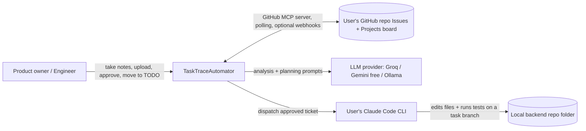
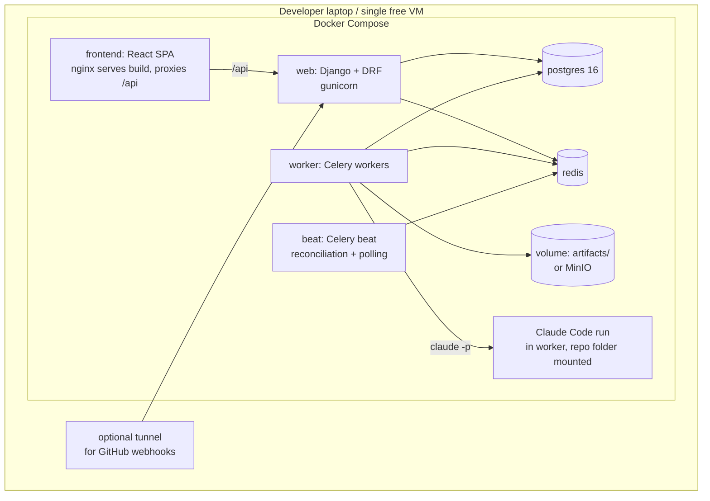
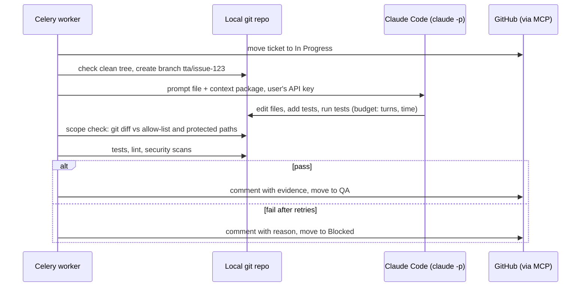
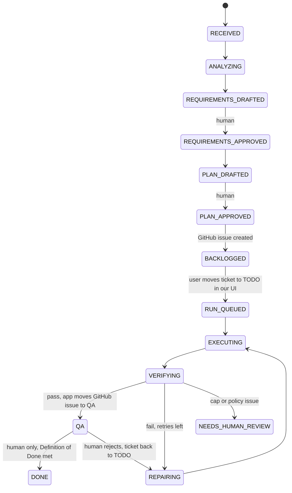

# TaskTraceAutomator — Architecture

**Reference:** [task_trace_automator_plan.md](task_trace_automator_plan.md) · High-level view: [task_trace_automator_hld.md](task_trace_automator_hld.md)
**Status:** Proposed architecture
**Cost principle:** Every component is free or open source and runs locally with Docker Compose. Paid services are optional and listed explicitly in section 12.

---

## 1. Goals and Scoping

The plan describes a production-grade platform. This document keeps the same core idea and workflow: meeting → requirements → plan → GitHub backlog tickets → Claude Code run → verification → QA. TaskTraceAutomator **orchestrates tools the customer already pays for** (their GitHub and their Claude Code). It does not replace them, and it does not host its own tracker or coding model. It makes the following trade-offs to stay free and buildable by a small team.

| Plan | This architecture | Reason |
|---|---|---|
| GitHub Issues + Projects as the ticket system | **The customer's own GitHub repo Issues and Projects (v2) board, through the GitHub MCP server.** The Planner agent creates issues and sub-issues through allow-listed MCP tools; the app performs every status change as a deterministic MCP client call (no LLM). The token is entered in the UI | The customer already uses GitHub and the MCP server gives agent-friendly tools without a custom API client. We create backlog tickets and drive status through MCP (see section 5.5) |
| Temporal durable workflows | **Celery + Redis + a persisted state machine in PostgreSQL** | Free and simple; durability comes from DB state and idempotency keys |
| S3 object storage | **Local filesystem / MinIO (free, optional)** | No cloud cost |
| Managed PostgreSQL | **PostgreSQL in Docker** | Free |
| Ephemeral hardened runners | **Local runner: Claude Code runs against the configured local repo folder, on a new git branch per task** | The agent must reach the user's local code. Isolation comes from the branch, the path allow-list, and post-run checks (section 6) |
| Paid transcription | **faster-whisper (local, open source)**; transcript upload is the primary path | Free |
| Hosted LLM only | **Pluggable provider: Groq / Gemini free tier / Ollama local** for Analyst and Planner | Free |
| Claude Code as Coding Agent | **The user's own Claude Code**, using the user's Anthropic API key entered in the UI (stored encrypted, passed to the CLI as `ANTHROPIC_API_KEY`) | Customers already pay for Claude Code. A subscription login is not the default; check Anthropic's terms before supporting it. See section 12 for the fallback |
| Full observability stack | **Structured logs + Django admin + audit table** | Free, minimal |
| Server-rendered UI | **React SPA (TypeScript, Vite) on top of the DRF API** | Rich board (drag and drop), live run status, typed API client generated from the OpenAPI schema |
| Multi-tenant orgs | **Single-tenant, project-level roles (Admin, Member, Non-member; see section 9.3)** | Out of MVP scope |

The MVP principle from the plan is kept: **one coding agent with staged responsibilities**, human approval gates, typed versioned artifacts, and no auto-merge.

**MVP scope:** backend coding only. Frontend tickets are created in GitHub but are not auto-run until the next MVP (design upload or design approval, then page creation). Commit, push, and pull request are manual. Automatic pull request creation through the same GitHub MCP server is a later good-to-have.

---

## 2. System Context



TaskTraceAutomator owns artifacts, approvals, policies, runs, and evidence. GitHub owns issue identity and board status. The local repo folder owns the code. GitHub is not the source of truth for the workflow itself: every status change that matters goes through our API and is checked against our state machine.

---

## 3. Container / Deployment View

Everything runs on one machine with `docker compose up`.



| Service | Image / tool | Responsibility |
|---|---|---|
| frontend | Node 20 build stage, nginx runtime | Serves the React build and proxies `/api` to `web`, so browser and API share one origin (no CORS) |
| web | Python 3.12, Django, DRF | REST API, approval endpoints, webhook receivers (no HTML rendering except Django admin) |
| github-mcp | GitHub's official MCP server (Docker image or remote endpoint), `issues` and `projects` toolsets enabled | Tool surface for the Planner agent (create issue, create sub-issue, add to project) and for the app's own MCP client calls (status updates, comments, reads). Holds the only GitHub token |
| worker | same image, Celery | All long-running work: ingest, analyze, plan, GitHub sync, run orchestration |
| beat | same image | GitHub polling and reconciliation, stuck-run detection, retry sweeps |
| postgres | postgres:16 | State, artifacts (JSONB), audit log |
| redis | redis:7 | Celery broker and result backend, short locks |
| runner | the worker image with git, Claude Code CLI, and the project's test tools, with the user's repo folder mounted at a configured path | Where the coding agent and verifier run. It must run on the same machine as the repo; a hosted instance cannot reach a local folder |
| tunnel (optional) | cloudflared (free) or ngrok free | Exposes the webhook endpoint to GitHub. Not needed when polling is used |

GitHub cannot send webhooks to `localhost`. **Polling is the default**: the beat job reads the project's issues and board items through the GitHub MCP server every 30–60 seconds. Webhooks are optional when a public URL exists.

---

## 4. Logical Architecture

```mermaid
flowchart LR
    subgraph Presentation
        UI[TaskTrace board<br/>React SPA]
        API[DRF REST API]
    end

    subgraph Application[Django apps]
        ACC[accounts]
        PRJ[projects]
        MTG[meetings]
        REQ[requirements]
        WI[work_items]
        RUNS[runs]
        VER[verification]
        INT[integrations]
        AUD[audit]
    end

    subgraph Orchestration
        SM[State machine service]
        TASKS[Celery tasks<br/>idempotent activities]
    end

    subgraph Agents
        MA[Meeting Analyst]
        PL[Planner]
        CB[Context Builder<br/>deterministic]
        CA[Coding Agent adapter<br/>Claude Code]
        VF[Verifier]
    end

    subgraph Adapters
        LLMA[LLM adapter]
        TRA[Transcription adapter]
        SCMA[Repository adapter: local git folder]
        TRK[Tracker adapter: GitHub]
    end

    UI --> API
    API --> Application
    Application --> SM
    SM --> TASKS
    TASKS --> Agents
    Agents --> Adapters
    Application --> PG[(PostgreSQL)]
    TASKS --> PG
```



### Layering rules

1. Views and serializers contain no business logic. They call service functions in each app (`services.py`).
2. Services change state only through the state machine, which writes an audit event in the same DB transaction.
3. Celery tasks are thin: load the object, check the idempotency key, call a service, record the outcome.
4. Adapters are the only code that talks to the outside world. Each is behind a Python `Protocol` so it can be swapped or mocked in tests. The tracker adapter keeps Linear or Trello possible later.

---

## 5. Component Design

### 5.1 Ingestion (`meetings`)
- **Mandatory sources:**
  1. Live "Take notes" (primary): the browser captures the user's mic plus tab/system audio after explicit consent and uploads it in chunks. This also covers a video playing on the user's system. Video file upload is not supported.
  2. Uploaded `.txt`, `.md`, `.vtt`, `.srt`.
  3. Typed text, chat-style, with an item type (new feature, bug, enhancement).
- **Good-to-have sources:** audio file upload (G2) and YouTube URL (G12, captions first, audio fallback only for authorised videos).
- Normalizes into `TranscriptSegment` rows (speaker, start, end, text, offset) with a SHA-256 checksum.
- Live and audio input go through **faster-whisper** (`small` or `base` model, CPU) in a Celery task. Text input skips this step.
- Basic limits: file size cap, extension allow-list.
- **Before any LLM call, for every source:** a regex secret/PII redactor, then a content moderation gate that rejects 18+, harassment, and illegal content with a clear reason.

### 5.2 Meeting Analyst (`agents/meeting_analyst`)
- One LLM call (or chunk-and-merge for long transcripts) with a JSON schema.
- Output validated with **Pydantic**; invalid output triggers one repair retry, then fails the task.
- Produces a `RequirementPackage` with decisions, goals, functional and non-functional requirements, constraints, open questions, and out-of-scope items. Each item carries `source_segment_ids` and a confidence value.
- No tools and no side effects. The transcript is passed as delimited, untrusted data.
- **Scope filter:** only pure coding work becomes action items. Business, ops, and other non-code tasks are listed as out of scope and never reach the Planner. For typed input, the user's item type (feature, bug, enhancement) is passed as a hint.

### 5.3 Planner (`agents/planner`)
- Input: approved requirement package and repository profile.
- Output: `WorkItem` (Given/When/Then criteria, definition of done, test plan) and `ImplementationPlan` (allowed paths, protected paths, test commands, diff budget).
- **Task type:** classifies each work item as `bug_fix`, `feature_addition`, `dependency_update`, `documentation`, or `config_change`. The type selects the coding skill (section 5.7). It is separate from the board category label (backend, frontend, bug, feature name).
- **Triage score:** scores each work item 1–10 for estimated complexity using the Repo Map and the acceptance criteria. Items above the project's `max_complexity` setting are flagged `Needs split` and cannot start a run until a human splits or accepts them. The score is stored on the `WorkItem` and later feeds effort estimates (G11.b).
- **Episodic memory:** before planning, reads the last few failed or escalated `CodingRun` rows for the same project and area (from `CodingRun` and `AuditEvent`) and shows them to the reviewer, so a failed approach is not repeated blindly.
- **Plan changes:** compares a proposed revision with the approved plan, writes a `PlanChange` with a diff and a reason, and requests approval. Only an approved `PlanChange` produces a GitHub sub-issue.

### 5.4 Context Builder (`agents/context_builder`) — deterministic first
No embeddings in the MVP. It uses:
- `git ls-files`, `ripgrep` keyword search, and Python `ast` / `ctags` for symbols;
- Django route and model discovery (`urls.py`, `models.py`, `tests/`);
- recent-change heat from `git log --name-only`.

It outputs a `ContextPackage` with files to read, files allowed to change, protected files, and conventions. The engineer can edit the allow-list during plan review. `pgvector` is an optional later addition.

**Repo Map.** The Context Builder also builds a compact **Repo Map**: a directory tree plus one entry per file (path, language, exported symbols, one-line description). It is capped at a configurable token budget (`repo_map_token_budget`, default 4000) by summarizing and truncating the least relevant directories first. The map is cached on disk and rebuilt only for files that changed since the last build (`git diff --name-only <last_commit>`). Retrieval of the top-K relevant files (default K=10) is keyword and symbol matching over the Repo Map; embeddings stay a later option (G6).

**Context rules.** The prompt carries file *paths* and reasons only, never raw file contents; the coding agent reads files on demand. Raw file text is never copied into the plan or the prompt file.

### 5.5 Tracker control plane (`integrations/github_tracker`)

The tracker is the **customer's own GitHub repository Issues and a GitHub Projects (v2) board**. The user first selects the **board owner type**, **Personal account** or **Organization**, and the form changes to match. Personal: owner login, repository, Project number, and a **classic** token with the `project` and `repo` scopes (GitHub fine-grained tokens cannot reach user-owned Projects v2 boards). Organization: organization login, repository, Project number, and either a classic token with `project` and `repo` or a **fine-grained** token whose resource owner is the organization, with Issues read/write and the organization Projects permission. Both types are supported in the MVP. The token is stored encrypted and never shown again. All tracker traffic goes through the **GitHub MCP server** (`issues` and `projects` toolsets), which is the only component that holds the token.

**Two callers, one MCP server.**

| Caller | What it may do | Why |
|---|---|---|
| **Planner agent** (LLM, via MCP tools) | Only an allow-list: create issue, create sub-issue (parent link), add issue to the Project. No close, delete, edit-other-issue, or status-change tools | Ticket content (summary, criteria, definition of done, sub-issue text) is judgment-heavy, so the agent writes it. The tool allow-list is enforced outside the prompt |
| **Tracker adapter** (deterministic MCP client, no LLM) | Status updates, comments, assignment, labels, reads, polling, reconciliation | Transitions must be deterministic, locked, idempotent, and audited |

After every Planner tool call the adapter verifies the result, stores the references in `ExternalIssue`, and writes an `AuditEvent`. Before creating anything it searches for the work-item marker (below) so a retried or timed-out call cannot create a duplicate.

| Capability needed | GitHub equivalent | Notes |
|---|---|---|
| Backlog issue per work item | Issue (MCP `create issue`) | Markdown body holds summary, criteria, plan version, and a hidden marker `<!-- tta:work_item=<id>;plan=<version> -->` used for idempotent lookup |
| Place on the board | Project item (MCP projects tools: add item) | Created in Backlog |
| Category: backend, frontend, bug, feature name | **Labels** | Set on creation. Only `backend` tickets are auto-run in the MVP |
| Status columns (Backlog, TODO, In Progress, QA, Blocked, Done) | The Project's single-select **Status** field | An issue itself is only open or closed; the board column is the Status field of the project item. Project settings map our states to the Status option names |
| Sub-issue for a plan change | GitHub **sub-issue** linked to the parent issue | Created by the Planner agent after the plan change is approved |
| Comments | Issue comments | Evidence, branch name, and report summary are posted here |
| Assign, priority | `assignees`, and a Project `Priority` field | |
| Block / unblock with reason | Status `Blocked` plus a comment | Reason is also stored in the audit log |
| Event on status change | Polling of project items (default) or optional repository webhook (`issues`, `projects_v2_item`) | See below |

**Reference format.** An issue is identified as `owner/repo#123` plus its node ID and its Project item ID, all stored in `ExternalIssue`. The Project item ID is what status updates use.

**Moving a ticket to TODO.** The UI has a "Move to TODO" action. It calls our endpoint, which checks the state machine, then the adapter updates the item's Status field through MCP and writes an `AuditEvent` with the user, time, and issue reference. Because the transition goes through our API, the move is **traced**: we know who moved what and when. The same call enqueues the run.

**Moves made directly in GitHub.** These are visible only through a webhook or a poll. The supported way is the TaskTrace UI. Polling lists the project's items with their Status and `updatedAt` as a safety net. A status change found by polling that was not made through our API is recorded as an external change. A move to TODO found this way starts a run only if the project setting `accept_github_side_moves` is on (default off). An illegal move found this way (for example straight to Done) is flagged on the ticket with a comment and recorded in the audit log.

**Who moves what.**
- The **app** moves Backlog → TODO (on user action), TODO → In Progress (run starts), In Progress → QA (tests pass), and any → Blocked (run fails or needs a decision).
- Only a **human** moves QA → Done, after manual testing and a Definition of Done check. The app never sets Done; when a human sets Done the issue is closed.
- The app's state machine, not Claude Code and not an LLM, performs every GitHub status change, so transitions are deterministic and audited.

Behavior:
- Creates backlog issues after plan approval. Idempotent: key = `work_item_id + plan_version`, embedded as the body marker and stored in `ExternalIssue`; a retry finds the existing issue instead of creating a duplicate.
- UI commands (move, comment, assign, block/unblock) are authenticated TaskTraceAutomator endpoints. Each one calls the MCP server and writes an audit event.
- If webhooks are enabled, they are persisted to `WebhookEvent`, deduplicated, and verified with the webhook secret (`X-Hub-Signature-256`).
- Beat polling reconciles GitHub state with internal state so missed events cannot strand tickets.
- GitHub rate limits (primary and secondary) are handled with retry and backoff on `403`/`429`, honouring `Retry-After`.
- Text in issue bodies and comments is untrusted data and is never fed to the Coding Agent; only the approved plan version is.

### 5.6 Run orchestrator (`runs`)
Triggered when a managed issue is moved to **TODO** through our UI (or found in TODO by polling, if `accept_github_side_moves` is on):
1. Verify the issue is in the configured project, is a `backend` ticket (MVP), links to an approved plan version, and has no active or completed run (unique constraint on `work_item + plan_version` for active runs).
2. Create `CodingRun`, move the GitHub issue to **In Progress**.
3. Build or load the `ContextPackage` from the configured local repo folder.
4. Create a new git branch for the task and start the Claude Code run (section 6).
5. Collect results and run verification. On `PASS`, post the evidence (branch name, diff summary, report) as a GitHub comment and move the ticket to **QA**. On `FAIL` after retries, move it to **Blocked** with the reason. Commit, push, and pull request are manual.
6. A human tests manually and moves the ticket to **Done** when the Definition of Done is met.

### 5.7 Coding Agent adapter (`agents/coding_agent`)
- Calls **Claude Code CLI in headless mode** (`claude -p`) inside the runner with a generated prompt file built from the ticket, plan, context package, and path policy. The prompt keeps instructions separate from untrusted content.
- Limits: `--max-turns`, wall-clock timeout, and a token/cost cap via the run budget.
- **Skills.** The prompt builder loads one versioned **skill** by the work item's task type from `prompts/skills/`. A skill is a structured object, not a free string: `name`, `instructions`, `workflow_steps`, `example_prompts`, and `forbidden_actions`. MVP skills: `bug_fix` (reproduce with a failing test, localize, fix, verify), `feature_addition` (read similar existing code first, design, implement, test, document), `dependency_update` (check the changelog, update the lockfile, resolve conflicts, run the full suite), `documentation` (read existing style, draft, check accuracy, update the index), and `config_change`. A run records the skill name and version.
- **Inner loop.** Every run follows the same order: read the context package files on demand, write a short change plan, make small surgical edits (no whole-file rewrites unless needed), run the configured tests, fix and retry on failure (cap 2, then `NEEDS_HUMAN_REVIEW`). Before finishing, the agent writes `proposed_diff.txt` (a unified diff) and `change_plan.md` into the run artifacts for the reviewer.
- **Lessons.** The prompt includes up to 3 past lessons most similar to the work item (section 5.11), labelled as untrusted hints, not instructions.
- Issue text is never fed to the agent directly. Only the internally approved plan version is used, as the plan requires.

### 5.8 Verifier (`verification` + runner)
Deterministic checks first, interpretation second. Free tools only:

| Check | Tool |
|---|---|
| Tests | project test command (pytest / npm test) |
| Lint / format | ruff, eslint |
| Types | mypy / pyright (if configured) |
| Static security | **bandit**, **semgrep (OSS rules)** |
| Dependency audit | **pip-audit** / `npm audit` |
| Secret scan | **gitleaks** |
| Scope check | `git diff --name-only` compared with allow-list and protected paths; diff-size cap |
| Traceability | each acceptance criterion mapped to a test id or explicit evidence in the report |

Result: `PASS`, `FAIL`, or `NEEDS_HUMAN_REVIEW`. On `FAIL` with retries left, structured failure feedback goes back to the same coding stage. Cap at 2 retries, then escalate.

**Environment failures are not code failures.** The Verifier classifies a failed check as `CODE_FAILURE` (tests ran and failed) or `ENVIRONMENT_FAILURE` (the test command could not start: missing dependency, bad config, collection error before any test ran). An environment failure does not consume a retry and does not go back to the coding agent; the run goes to `NEEDS_HUMAN_REVIEW` with a report that says the environment must be fixed.

**Suggested commit message.** The verification report includes a structured commit message the user can copy. Commit and push stay manual:

```text
fix(#<issue>): <one-line summary>

- <what changed>
- <why>
- Closes #<issue>
```

The type prefix follows the task type (`fix`, `feat`, `chore`, `docs`).

### 5.9 Human Gate (`requirements`, `work_items`)
An `Approval` row stores user, artifact type, artifact id and version, decision, comment, and time. Approving a new version supersedes older approvals. Approval endpoints require the current version number and return 409 if it is stale.

### 5.10 Audit (`audit`)
Append-only `AuditEvent` table. The application DB role has `INSERT`/`SELECT` only on it. It records state transitions, approvals, board commands, webhooks received, prompts (hashed plus stored reference), tool results, blocked tool attempts, diffs, and checks.

### 5.11 Memory (`projects`, `runs`)
Three tiers, kept simple and in PostgreSQL:

| Tier | What it holds | Where | Used by |
|---|---|---|---|
| Working | The current task: work item, plan version, Repo Map slice, relevant files, diff, test results, retry count | `ContextPackage` and `CodingRun` state, passed explicitly to each stage; never relied on from chat history | Run orchestrator, prompt builder |
| Episodic | Recent outcomes for the project: which work items failed or escalated, and why | `CodingRun`, `VerificationReport`, `AuditEvent` (read-only query) | Planner (section 5.3) |
| Semantic | `Lesson` rows: what the issue was, which files changed, which approach worked | `Lesson` table, written when a human moves QA → Done | Prompt builder (top 3 by keyword match on task type, paths, and title) |

A lesson is written only after a human marks the ticket Done, because a human-verified outcome is a better signal than a generated diff. Lessons are untrusted text: they are shown to the agent as hints and never as instructions. Vector search for lessons is part of G6.

---

## 6. Execution Sandbox

The coding agent edits the user's **local backend folder**, so isolation is done with git and policy, not with a container per run.



Controls:
- Work only starts on a clean working tree. Every task gets its own branch (`tta/issue-<number>`), so a bad run is discarded by deleting the branch. Nothing is committed to `main`, and nothing is pushed.
- Claude Code runs with a restricted tool set and permission mode so it can only edit files and run the configured test and lint commands inside the repo folder.
- **Pre-execution guardrails** (first layer, before anything runs). The runner writes a per-run Claude Code settings file with deny rules and a `PreToolUse` hook that block, before execution: `rm -rf`, `curl`, `wget`, package installs from the network (`pip install`, `npm install`), `git push`, any command or path outside the repo folder, and edits to `.env`, `*.pem`, `*.key`, `*.secret`, and `*credentials*`. The exact rule and hook syntax is confirmed against the current Claude Code documentation during T4.1.d. A blocked attempt is written to the `AuditEvent` log with the command or path the agent wanted, and the run stops in `NEEDS_HUMAN_REVIEW` so a human can see what it tried. A human may approve a one-time exception only for the paths and commands in the approved plan; secrets and `git push` are never approvable from the run screen.
- Isolation option: a git worktree per task (a separate checkout outside the user's working folder) is a later good-to-have (G13). The MVP keeps the clean-tree check and the task branch.
- Runs have a turn limit, a wall-clock timeout, and a cost cap.
- Scope is enforced **outside the model** as a second layer: after the run the worker diffs against the allow-list and protected paths and rejects violations regardless of what the agent claims. Protected paths include `.env`, secrets, CI config, and lock files unless allowed.
- The user's Anthropic API key is stored encrypted and passed to the process as an environment variable only for the run. The GitHub token is held only by the GitHub MCP server and is never given to Claude Code.
- Commit, push, and pull request are done by the user. GitHub pull request creation through the MCP server is a later good-to-have.

---

## 7. State Machine

The state machine in section 9 of the plan is kept. It is implemented as:
- a `status` column on `Meeting`, `WorkItem`, and `CodingRun`;
- a `transition(obj, to_state, actor, command_id)` service that checks the allowed-transition table, enforces locking (`SELECT … FOR UPDATE`), writes the `AuditEvent`, and rejects a repeated `command_id` as a no-op;
- Celery tasks that are re-enqueued from the DB state, not from message content, so a worker crash resumes cleanly.



**Durability without Temporal:** use `acks_late=True`, `task_reject_on_worker_lost=True`, per-activity idempotency keys stored in an `ActivityLog` table (`key`, `status`, `result_ref`), and a beat job that re-enqueues runs stuck in a non-terminal state past a timeout. External side effects (create GitHub issue, GitHub transition, comment) check `ActivityLog` and the stored external reference before acting.

---

## 8. Data Architecture

### 8.1 Storage
| Data | Store |
|---|---|
| Domain objects, versions, approvals, audit | PostgreSQL |
| Evolving model output | JSONB columns, with hot fields promoted to columns |
| Recordings, large logs, patches, reports | Local volume `artifacts/` (path + SHA-256 in DB); MinIO is optional |
| Queue and locks | Redis |
| Search | PostgreSQL full-text search (no vector DB in MVP) |

### 8.2 Core tables
The ER model in section 10 of the plan applies. Additions:

| Table | Purpose |
|---|---|
| `ExternalIssue` | `work_item_id`, `plan_version`, `issue_ref` (`owner/repo#123`), `issue_number`, `issue_node_id`, `project_item_id`, `parent_issue_number`, `last_status`, `synced_at` |
| `PlanChange` | `implementation_plan_id`, `from_version`, `to_version`, `diff`, `reason`, `status`, `sub_issue_ref` |
| `ActivityLog` | Idempotency keys for side-effecting tasks |
| `Lesson` | `project_id`, `work_item_id`, `task_type`, `title`, `files_changed`, `approach`, `outcome`, `created_at` (written when a human moves QA → Done) |
| `WebhookEvent` | Raw inbound event, delivery ID, signature result, processed flag |
| `ModelCall` | Provider, model, prompt version, tokens, latency, cost (zero for free tiers) |

### 8.3 Rules
- UUID public IDs; approved artifacts are immutable, and edits create a new version.
- Prompts, JSON schemas, and tool policies live in the repo with a version string; each artifact records the versions used.
- Secrets exist only in environment variables or Docker secrets (`.env` is git-ignored), never in artifacts or prompts. User-supplied credentials (GitHub token, Anthropic API key) entered in the UI are stored encrypted at rest and never returned by the API.

---

## 9. API and UI

### 9.1 REST
Resources follow section 11.1 of the plan with tracker-neutral names:

```text
POST /api/implementation-plans/{id}/create-issues/      # Planner agent creates GitHub backlog issues (MCP)
PUT  /api/projects/{id}/integrations/github/              # owner, repo, Project number, token, status mapping
PUT  /api/projects/{id}/integrations/claude/            # Anthropic API key, model, repo folder path
POST /api/projects/{id}/integrations/{kind}/test/       # test connection
POST /api/plan-changes/{id}/approve/
POST /api/integrations/github/webhook/                    # optional
POST /api/issues/{issue_ref}/transition/                      # e.g. Backlog -> TODO; Done is human-only
POST /api/issues/{issue_ref}/comments/
POST /api/issues/{issue_ref}/sub-issues/
GET  /api/issues/{issue_ref}/timeline/
```

Conventions:
- DRF with `drf-spectacular` for free OpenAPI docs at `/api/docs/`.
- **Bearer token auth** with JWT (`djangorestframework-simplejwt`). Every request sends `Authorization: Bearer <access token>`; no session cookies, so no CSRF handling is needed for API calls.
- Auth endpoints: `POST /api/auth/login/` (returns a 15-minute access token and a 7-day refresh token), `POST /api/auth/refresh/`, `POST /api/auth/logout/` (blacklists the refresh token), `GET /api/auth/me/` (user, memberships, role, access level), `POST /api/auth/change-password/`.
- The SPA keeps tokens in memory only (not `localStorage`). On a `401` it refreshes once and retries; if that fails it redirects to `/login`.
- Login is rate-limited with lockout after repeated failures; login, logout, and failed attempts are audit events.
- The OpenAPI schema is the contract with the frontend: the TypeScript client and types are generated from it (`openapi-typescript`), and CI fails if the generated client is out of date.
- Mutations accept an `Idempotency-Key` header; long operations return `202` with a run id and status URL.
- Role and access-level check (section 9.3) in a DRF permission class; the SPA only hides controls, the API enforces.

### 9.2 UI (TaskTrace board)
A **React 18 + TypeScript** single-page app built with **Vite**. The backend stays the only place that enforces workflow rules; the SPA displays state and sends commands.

| Concern | Choice |
|---|---|
| Routing | React Router |
| Server state and polling | TanStack Query (`refetchInterval` of 3 s for active runs) |
| Drag and drop (board) | dnd-kit; a drop calls the transition endpoint and the card snaps back if the backend rejects the move |
| Styling | Tailwind CSS (build step), headless components |
| API client | Generated from the OpenAPI schema with `openapi-typescript` |
| Diff view | react-diff-view or similar |
| Forms | React Hook Form + Zod |

Live updates start as polling. Server-sent events are a later upgrade and need no new infrastructure beyond an ASGI endpoint.

**Public page:** `/login` takes username or email and password, shows error and "session expired" states, and on success stores the tokens in memory and goes to the Dashboard.

**Pages after login** (inside an app shell with sidebar, project switcher, and user menu). Columns show access for each role: Non-member (Viewer access), Member (Approver access), Admin (Full access). "read" means view only.

| Route | Page and content | Non-member | Member | Admin |
|---|---|---|---|---|
| `/` | Dashboard: projects, runs needing attention, pending approvals, recent activity | read | ✔ | ✔ |
| `/projects` | Projects list | read | ✔ | ✔ + create |
| `/projects/:id/settings` | GitHub connection, Claude connection (API key, model), local repo folder, path policy, test commands, members | — | — | ✔ |
| `/projects/:id/meetings` | Meetings list and status | read | ✔ | ✔ |
| `/projects/:id/meetings/new` | Upload or paste transcript | — | ✔ | ✔ |
| `/meetings/:id` | Requirement review: transcript with highlighted source spans, edit, split, delete, open questions, approve | read | ✔ | ✔ |
| `/work-items/:id/plan` | Plan review: criteria, allow-list editor with reasons, versions, approve | read | ✔ | ✔ |
| `/plan-changes/:id` | Plan change: diff against approved plan, reason, approve or reject | read | ✔ | ✔ |
| `/projects/:id/board` | Board: Backlog, TODO, In Progress, QA, Blocked, Done; move to TODO, comment, assign, block/unblock; Done only by a human with a Definition of Done checklist | read | ✔ | ✔ |
| `/issues/:key` | Ticket detail: links to plan and requirements, comments, timeline | read | ✔ | ✔ |
| `/runs/:id` | Run detail: live status (polling every 3 s), logs, diff, verification report, traceability, branch name | read | ✔ | ✔ |
| `/approvals` | Inbox of pending requirements, plans, and plan changes | — | ✔ | ✔ |
| `/audit` | Audit timeline: per work item for all; project-wide for Admin | item-level | item-level | ✔ all |
| `/admin/users` | Users, roles, project membership | — | — | ✔ |
| `/profile` | Change password, sign out | ✔ | ✔ | ✔ |
| `*` | 401, 403, 404, and error pages | ✔ | ✔ | ✔ |

Later or good-to-have: evaluation results page, cost and usage page, forgot/reset password.

### 9.3 Roles and access levels
A **role** is what a user is in a project. An **access level** is what that role may do. Viewer and Approver are access levels, not roles.

| Role | Access level | Meaning |
|---|---|---|
| Non-member | **Viewer** | Authenticated user given read access to a project but not on its team. Read only. |
| Member | **Approver** | Everything a Viewer can do, plus create, edit, approve, and operate the board. |
| Admin | **Full** | Everything a Member can do, plus administration. |

A user with no access to a project sees nothing of it.

| Action | Non-member (Viewer) | Member (Approver) | Admin (Full) |
|---|---|---|---|
| Log in, view own profile, change own password | ✔ | ✔ | ✔ |
| View projects, meetings, requirements, plans, board, tickets, runs, reports, diffs, and audit for their projects | ✔ | ✔ | ✔ |
| Upload or paste a transcript | — | ✔ | ✔ |
| Edit, split, delete, add requirement items; resolve open questions | — | ✔ | ✔ |
| Approve requirements | — | ✔ | ✔ |
| Edit plan and allow-list; approve plan | — | ✔ | ✔ |
| Propose, approve, or reject plan changes | — | ✔ | ✔ |
| Move cards (including to TODO, which starts a run), comment, assign, block/unblock | — | ✔ | ✔ |
| Cancel or retry a run | — | ✔ | ✔ |
| Move a ticket from QA to Done after manual testing (human only) | — | ✔ | ✔ |
| Create a project; edit project settings (GitHub and Claude connections, repo folder, path policy, test commands) | — | — | ✔ |
| Manage users, roles, and project membership | — | — | ✔ |
| View project-wide and global audit log | — | — | ✔ |

Whether the author of an artifact may also be its only approver is a project policy to be decided in a later task.

---

## 10. Security and Governance

| Threat | Control |
|---|---|
| Prompt injection from transcript, code, or issue text | Untrusted content wrapped in delimited blocks; Analyst has no tools; coding agent only receives approved plan; scope enforced after the run |
| Secret leakage | gitleaks before push; regex redaction on transcripts and logs; secrets only in env |
| Prohibited content (18+, harassment, illegal) | Moderation gate on every input source before any LLM call; rejected input is not analysed and the reason is shown to the user |
| Recording without consent | "Take notes" requires an explicit consent prompt and shows a visible recording state; capture stops when the user stops it |
| Agent edits protected files | Post-run diff check against path policy; failure blocks the move to QA and the ticket goes to Blocked |
| Unauthorized actions | Bearer-token auth, role and access-level permission class (section 9.3), approval-version checks, HMAC-verified webhooks |
| Token theft or brute force | Short-lived access tokens held in memory only, refresh-token blacklist on logout, login rate limit and lockout, auth events audited |
| Illegal board moves made directly in GitHub | Moves through our UI are validated by the state machine; moves found by polling are flagged with a comment and an audit event. The app never sets Done |
| Duplicate or replayed commands | Idempotency keys, unique constraints, `WebhookEvent` dedupe by delivery ID |
| Runaway cost or time | Per-run budget (turns, time, tokens), retry cap of 2 |
| Auto-merge | Not possible: bot token has no merge rights, `main` is branch-protected |
| Provider data exposure | Provider choice per project; a local Ollama option keeps data on the machine |

Documented but not built in the first version: multi-tenant isolation, KMS, formal retention workflows.

---

## 11. Observability and Testing

### Observability (free)
- Structured JSON logs (`structlog`) with `run_id`, `work_item_id`, and `command_id` on every line.
- Django admin as the operations console.
- `ModelCall` and `CodingRun` tables supply cost, latency, and failure-category numbers for evaluation.
- Optional: Prometheus + Grafana containers.

### Testing strategy
| Level | Tooling |
|---|---|
| Unit | pytest, pytest-django |
| Adapter contract tests | Recorded MCP tool-call fixtures or a fake MCP server, mocks for LLM |
| State machine tests | Table-driven transition and idempotency tests |
| Workflow tests | Kill worker mid-run, duplicate webhook, delayed webhook, illegal card move |
| Agent evaluation | Small fixed set of 5–10 meetings with expected requirements, and 5–10 repo tasks, scored per the plan's metrics |
| Frontend unit and component | Vitest, React Testing Library, MSW to mock the API |
| Frontend end-to-end | Playwright for the core path (upload, approve, move card to TODO, view report); optional |
| Security | Injection fixtures in transcripts and repo files; assert the scope guard blocks them |
| CI for this project's own repo | **GitHub Actions free tier**: lint, tests, bandit, gitleaks, frontend lint (ESLint), type check (`tsc`), Vitest, and OpenAPI client drift check |

---

## 12. Technology Stack and Cost

| Concern | Choice | Cost |
|---|---|---|
| Language / framework | Python 3.12, Django 5, Django REST Framework | Free |
| Database | PostgreSQL 16 | Free |
| Queue / workers | Celery + Redis | Free |
| Validation | Pydantic v2 for LLM outputs | Free |
| Authentication | JWT bearer tokens via djangorestframework-simplejwt (with token blacklist) | Free |
| UI | React 18, TypeScript, Vite, React Router, TanStack Query, Tailwind CSS, dnd-kit | Free |
| Frontend tooling | Node 20, npm or pnpm, ESLint, Vitest, React Testing Library, Playwright (optional), openapi-typescript | Free |
| Web server for the SPA | nginx (in the `frontend` container) | Free |
| Transcription | faster-whisper (local) | Free |
| LLM for Analyst and Planner | Groq free tier, Google Gemini free tier, or Ollama (Llama 3.x / Qwen) locally, behind one adapter | Free |
| Coding agent | **The user's own Claude Code CLI** | The customer's existing cost (see below) |
| Ticketing / kanban | The customer's GitHub Issues and Projects (v2) board, GitHub MCP server | Customer's existing GitHub; one tool surface for the Planner agent and the app |
| Source control | Local git folder, manual commit, push, and PR | Free |
| Runtime | Docker Compose with the repo folder mounted into the worker | Free |
| Webhook tunnel (optional) | cloudflared or ngrok free | Free |
| Security scans | bandit, semgrep OSS, gitleaks, pip-audit | Free |
| Deployment | Docker Compose on laptop; optional free VM (Oracle Cloud Always Free) | Free |
| API docs | drf-spectacular | Free |

**The one cost to plan for:** Claude Code runs on the customer's own Anthropic API key (Claude Code reads `ANTHROPIC_API_KEY`), which the customer already pays for. A subscription login is not the default; check Anthropic's current terms before supporting it inside another product. To keep spend minimal:
- limit demos to small tasks with `--max-turns` and a per-run token cap;
- use the cheapest suitable model for the coding stage;
- cache the context package so retries do not re-run analysis.

**Free fallback:** because the Coding Agent is behind an adapter, a free alternative (for example **Aider** or **OpenHands** pointed at a free Gemini or Groq key, or a local Ollama model) can be dropped in with the same contract: input is a prompt file and workspace, output is a diff and `result.json`. Quality will be lower, but the entire pipeline stays at zero cost.

---

## 13. Repository Layout

```text
tasktraceautomator/
├── docker-compose.yml
├── .env.example
├── api/                        # All backend code (Django, Celery, agents, runner)
│   ├── Dockerfile              # web/worker image
│   ├── manage.py
│   ├── pyproject.toml          # Ruff, mypy, pytest config
│   ├── requirements.txt
│   ├── requirements-dev.txt
│   ├── config/                 # settings, urls, celery.py
│   ├── apps/
│   │   ├── accounts/  projects/  meetings/  requirements/
│   │   ├── work_items/  runs/  verification/  integrations/  audit/
│   ├── agents/
│   │   ├── meeting_analyst/  planner/  context_builder/  coding_agent/
│   ├── providers/              # llm/, transcription/, repository/, tracker/
│   ├── schemas/                # JSON/Pydantic artifact contracts
│   ├── prompts/                # versioned stage prompts
│   ├── runner/
│   │   └── run_task.py         # check clean tree, create branch, run claude -p, scan, emit result.json
│   └── tests/
│       ├── unit/  integration/  workflow/  evaluation/
├── app/                        # All frontend code (React + TypeScript SPA with Vite)
│   ├── Dockerfile              # Node build stage, nginx runtime
│   ├── nginx.conf              # serves build, proxies /api to web
│   ├── src/
│   │   ├── api/                # generated OpenAPI client and types
│   │   ├── features/           # projects, meetings, plans, board, runs, audit
│   │   ├── components/  routes/
│   │   └── tests/
│   └── package.json  vite.config.ts  tsconfig.json
└── docs/
    └── architecture/
```

---

## 14. Build Order

| Phase | Deliverable | Exit check |
|---|---|---|
| 0. Foundation | Compose stack, Django apps, models, audit, state machine, auth | Transitions are tested and idempotent |
| 1. Understand | Transcript upload, Analyst, requirement review UI, approvals | A draft package is corrected and approved |
| 2. Plan | Planner, Context Builder, plan review with allow-list, plan versions | Reviewer can see why each file is in scope |
| 3. Tracker | GitHub and Claude connection settings, GitHub issue creation, board UI, Move to TODO, polling and reconciliation, `PlanChange` sub-issues | Moving a ticket to TODO in the UI creates a queued run exactly once |
| 4. Build and verify | Local runner, Claude Code adapter, scope enforcement, scanners, report, move to QA | A bad run (out-of-scope edit) is blocked; a good run leaves a branch and moves the ticket to QA |
| 5. Hardening | Retry cap, crash recovery, duplicate and delayed webhook tests | Restarting a worker mid-run does not duplicate GitHub issues or runs |
| 6. Evaluation | Run fixed evaluation set, collect metrics | Report compares the staged agent against a manual baseline |

**Good-to-have options** (tracked as G1–G13 in `../implementation_plan/task.md`; none block an exit check):
- **G1** GitHub pull request creation: `create_pull_request` project setting, **default off**. Later good-to-have. In the MVP commit, push, and PR are manual and the branch, diff, and report are the handoff.
- **G2** Audio transcription (faster-whisper). **G3** MinIO storage. **G4** Prometheus and Grafana. **G5** Free fallback coding agent. **G6** pgvector retrieval. **G7** Linear or Trello adapters (the tracker adapter boundary allows them). **G8** Specialist agents, only after a measured benefit. **G9** Hosted deployment on a free VM. **G10** Server-sent events instead of polling. **G13** Git worktree per task for isolation and parallel runs. **G11** Scrum assistant: advisory process support (priority ordering, effort estimates, blocker nudges, weekly summary) that only suggests and never moves tickets or approves.

**Cut line if time is short:** drop the good-to-have options. Keep the transcript → requirements → plan → GitHub issue → Claude Code → QA path with human gates.

---

## 15. Risks Specific to This Architecture

| Risk | Mitigation |
|---|---|
| Celery lacks Temporal-style replay | Persisted state machine, `ActivityLog` idempotency, reconciliation beat job, crash tests |
| Free LLM tiers rate-limit or produce weaker JSON | Pydantic validation with one repair retry, chunking, provider fallback chain, small transcripts for demos |
| GitHub webhooks unreachable on a laptop | Polling is the default; webhooks are optional |
| Users move tickets directly in GitHub | UI is the supported path; polling flags illegal moves; the app never sets Done |
| Claude Code edits the user's real folder | Clean-tree check, per-task branch, path allow-list, post-run diff check, no commit or push |
| Project board lacks our Status options | Status mapping in project settings, with a connection test that lists missing Status field options |
| The Planner agent (LLM with write tools) creates duplicate or wrong issues, or is prompt-injected | Tool allow-list enforced outside the prompt (create issue, create sub-issue, add to project only), work-item marker lookup before create, adapter verifies and records every result, token scoped to one repo and Project, status changes only by the app |
| Claude Code cost | Budget caps, small tasks, adapter fallback |
| Scope creep toward multi-agent | Single-agent baseline first; specialists only after measured benefit, per the plan |
