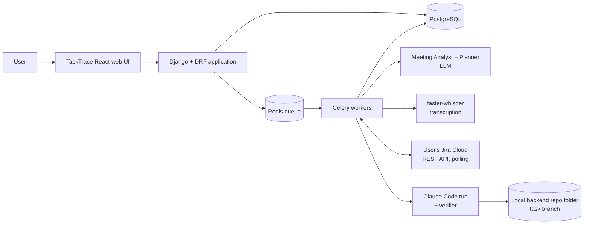
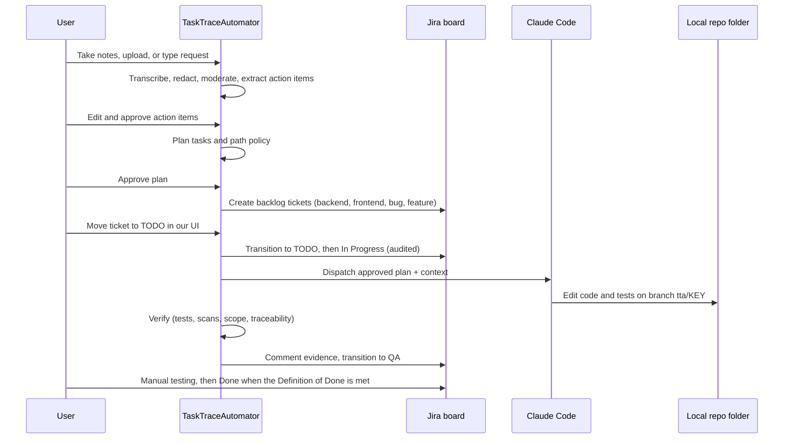

# TaskTraceAutomator — High-Level Design (HLD)

**Related:** [Plan](task_trace_automator_plan.md) · [Detailed architecture](task_trace_automator_architecture.md)
**Audience:** Product owner, engineers, reviewers who need the system on one page.

---

## 1. Purpose

TaskTraceAutomator turns a meeting into reviewed, verified code changes with every step traceable and every consequential step approved by a human. It **orchestrates tools the customer already pays for**: their Jira board and their Claude Code. It does not replace either.

```text
Meeting  →  Action items  →  Plan/tasks  →  Jira backlog  →  TODO  →  Claude Code run  →  QA  →  Done
            (approve)        (approve)      (our API)      (our UI)   (tests included)  (app)   (human)
```

## 2. Scope

**In scope (MVP)**
- Input: live "Take notes" (browser mic and tab audio, primary), uploaded `.txt`, `.md`, `.vtt`, `.srt`, and typed text with an item type (new feature, bug, enhancement).
- Redaction and content moderation (no 18+, harassment, or illegal content) before any LLM call.
- Action-item extraction (pure coding work only) with human approval, then planning into tasks with human approval.
- Tasks categorized as backend, frontend, bug, or feature name.
- Creating the tasks in the **user's own Jira board backlog** through the Jira API. The Jira connection is set in the UI.
- A "Move to TODO" action in our UI that calls the Jira transition API. The move goes through our API, so it is traced.
- Automatic run of the **user's own Claude Code** (API key set in the UI) against the configured **local backend folder**, including tests. **Backend coding only** in this MVP.
- On success the app moves the ticket to **QA** and comments the evidence. A human tests manually and moves it to **Done** when the Definition of Done is met.
- Commit, push, and pull request are **manual**.
- Full audit trail.

**Next MVP:** frontend coding (from an uploaded design, or a generated design that a human approves first).

**Good-to-have** (not needed for the MVP): audio file upload, YouTube URL, GitHub integration and PR creation, MinIO storage, Prometheus/Grafana, free fallback coding agent, pgvector retrieval, other trackers (Linear, Trello), IDE extension or Claude Code plugin, specialist agents, hosted deployment, server-sent events, scrum assistant. See `../implementation_plan/plan.md`.

**Out of scope**
- Auto-merge or deployment.
- Meeting bots that join Zoom, Meet, or Teams; video file upload.
- Our own tracker or our own coding model.
- Multi-repo runs, multi-tenant administration.
- Multiple specialist coding agents (only after a measured benefit).

## 3. Key Design Decisions

| # | Decision | Why |
|---|---|---|
| 1 | One coding agent with staged responsibilities | Establish a baseline before adding complexity |
| 2 | Typed, versioned artifacts instead of chat history | Auditable, resumable, reviewable |
| 3 | Human approval at action items, plan, plan changes, and Done | Intent and code stay human-accountable |
| 4 | The customer's Jira is the ticket system; the app drives it through the Jira API | Customers already pay for Jira; we orchestrate instead of replacing it |
| 5 | The app, not the model, performs every Jira transition; the app never sets Done | Deterministic, audited, human-owned completion |
| 6 | The user's own Claude Code runs the work, using the user's API key | Customers already pay for Claude Code |
| 7 | Persisted state machine + Celery/Redis | Durable and free; replaces a workflow engine |
| 8 | Scope and security enforced outside the model | The model is not trusted to police itself |
| 9 | Adapters for LLM, transcription, repo, tracker, coding agent | Every external dependency can be swapped or mocked |

## 4. System Overview



## 5. Major Components

| Component | Role |
|---|---|
| **Web UI (React SPA)** | Take notes, meeting review, plan review, board with Move to TODO, run detail, settings for the Jira and Claude connections, audit timeline; talks only to the REST API |
| **API (Django + DRF)** | REST API with JWT bearer auth, approvals, and idempotency keys; the OpenAPI schema generates the UI's typed client |
| **Roles and access** | Three roles: Admin (Full access), Member (Approver access: edit, approve, operate the board), Non-member (Viewer access: read only). Viewer and Approver are access levels, not roles. |
| **Meeting Analyst** | Extracts action items (coding work only) with source references; applies moderation and redaction first |
| **Planner** | Produces tasks, acceptance criteria, test plan, path policy, and a category; proposes plan changes |
| **Context Builder** | Deterministic selection of relevant files, allowed and protected paths |
| **Tracker adapter (Jira)** | Creates tickets and sub-tasks, performs transitions, comments, polls and reconciles status |
| **Run orchestrator** | Starts exactly one run per approved backend ticket moved to TODO; manages retries and escalation |
| **Coding agent runner** | The user's Claude Code on the local repo folder, on a new branch per task, with budgets |
| **Verifier** | Tests, lint, security and secret scans, scope check, acceptance-criteria traceability |
| **Human gate** | Records versioned approvals; stale approvals are rejected |
| **Audit log** | Append-only record of transitions, commands, prompts, diffs, and checks |

## 6. End-to-End Flow



**Plan change after approval:** Planner writes a new plan version and a diff, a human approves it, and a sub-task is created under the parent ticket. It runs only when the sub-task itself reaches TODO.

## 7. Workflow States

```text
RECEIVED → ANALYZING → REQUIREMENTS_DRAFTED → REQUIREMENTS_APPROVED
→ PLAN_DRAFTED → PLAN_APPROVED → BACKLOGGED → RUN_QUEUED → EXECUTING
→ VERIFYING → QA → DONE (human only)

VERIFYING → REPAIRING → EXECUTING        (max 2 retries)
VERIFYING → NEEDS_HUMAN_REVIEW           (retry cap or policy violation; ticket goes to Blocked)
QA → REPAIRING                           (human rejects; ticket back to TODO)
```

Jira board columns: Backlog, TODO, In Progress, QA, Blocked, Done. Every transition is idempotent, locked, and written to the audit log. Moves made directly in Jira are detected by polling and flagged; the UI is the supported path.

## 8. Data Overview

| Group | Entities |
|---|---|
| Input | Project, Meeting, MeetingSource, TranscriptSegment |
| Understanding | RequirementPackage, RequirementItem, Approval |
| Planning | WorkItem, ImplementationPlan, PlanChange, ContextPackage |
| Execution | CodingRun, VerificationReport, ActivityLog |
| Integration | ExternalIssue (Jira key), WebhookEvent (optional), connection settings (encrypted) |
| Governance | AuditEvent, ModelCall |

PostgreSQL holds structured data and JSONB artifacts. Large files (recordings, logs, patches) sit on a local volume or MinIO with checksums in the database.

## 9. Technology Summary

| Layer | Choice |
|---|---|
| Backend | Python, Django, Django REST Framework, Pydantic, simplejwt (bearer tokens) |
| Async | Celery, Redis |
| Data | PostgreSQL |
| UI | React 18, TypeScript, Vite, TanStack Query, Tailwind CSS, dnd-kit; served by nginx |
| AI | Free LLM tier (Groq / Gemini) or Ollama; faster-whisper; the user's Claude Code CLI for coding |
| Tracker | The customer's Jira Cloud, REST API v3 |
| Repo | Local git folder; commit, push, and PR are manual |
| Runtime | Docker Compose with the repo folder mounted into the worker |
| Verification | pytest, ruff, bandit, semgrep, gitleaks, pip-audit |
| Deployment | Docker Compose on the machine that holds the repo; optional tunnel for Jira webhooks |

## 10. Security Summary

- Meeting text, repo files, and ticket text are treated as untrusted data.
- Content moderation and secret/PII redaction run before any LLM call.
- The coding agent receives only the approved plan, never raw ticket text.
- Path allow-list and protected paths are enforced after the run, outside the model.
- Claude Code works on a clean tree, on its own branch, with limited tools; nothing is committed or pushed.
- The Jira token and Anthropic API key are encrypted at rest and never returned by the API.
- Recording requires explicit consent and shows a visible recording state.
- Budgets cap turns, time, tokens, diff size, and retries.

## 11. Non-Functional Targets

| Area | Target |
|---|---|
| Recoverability | Worker restart or duplicate event never creates duplicate Jira tickets or runs |
| Traceability | Every requirement, criterion, test, and diff is linked back to its source; every status change has an actor |
| Safety | Zero out-of-scope changes reach QA |
| Cost | Free infrastructure; bounded Claude Code spend per run on the customer's own key |
| Usability | Users complete the whole flow from the TaskTrace UI |

## 12. Risks (Summary)

| Risk | Mitigation |
|---|---|
| Weak free-LLM output | Schema validation, repair retry, chunking, provider fallback |
| Jira webhooks unavailable locally | Polling is the default |
| Users move tickets directly in Jira | UI is the supported path; polling flags illegal moves; the app never sets Done |
| Claude Code edits the user's real folder | Clean-tree check, task branch, path allow-list, post-run diff check |
| Claude Code cost or terms | Customer's own API key, budgets, small tasks, swappable agent adapter |
| Scope creep to multi-agent | Baseline first, specialists only on evidence |

## 13. Delivery Phases

1. Foundation: models, state machine, audit, auth.
2. Understand: ingestion, Analyst, action-item review.
3. Plan: Planner, Context Builder, plan review.
4. Tracker: Jira and Claude connection settings, Jira ticket creation, board, Move to TODO, polling.
5. Build and verify: local runner, Claude Code, verification, move to QA.
6. Hardening: retries, crash and duplicate-event tests.
7. Evaluation: fixed test set against a manual baseline.
