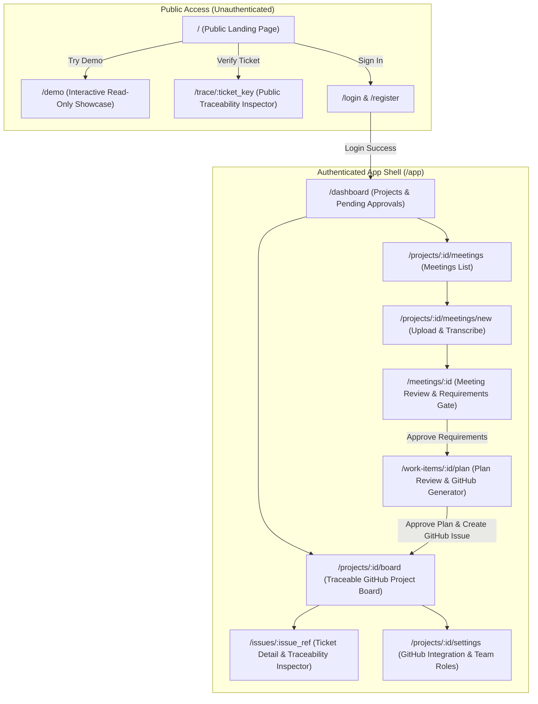

# TaskTraceAutomator — UI/UX Design System & Information Architecture

This directory contains the complete user interface specifications, wireframes, component layouts, and interaction designs for TaskTraceAutomator.

---

## 1. Design Philosophy: Anti-"Vibe Coding" Traceability

"Vibe coding" relies on unverified conversational prompts that produce un-audited code, loss of meeting decisions, and untraceable bugs. TaskTraceAutomator enforces visual and operational rigor:

1. **Explicit Provenance Over Magic**: Every requirement and GitHub issue must visibly link back to the exact sentence and timestamp in the meeting recording.
2. **Human Approval Gates**: Software intent and implementation plans must be approved by a human before backlog tickets are dispatched or executed.
3. **Dual-Pane Context Co-Location**: Review screens always show source material (transcript/audio) side-by-side with extracted artifacts (requirements/plan).
4. **Deterministic Visual Status**: State machine progression is clearly color-coded, with clear indications of GitHub sync status.

---

## 2. Information Architecture & Navigation Map

---

## 3. Design System & Style Tokens

| Element | Specification | Tailwind Class Equivalent |
|---|---|---|
| **Base Theme** | Clean, modern developer-centric dark/light theme | `bg-slate-900` / `bg-slate-950` text: `text-slate-100` |
| **Surface Cards** | Elevated slate panels with subtle 1px border | `bg-slate-800/80 border border-slate-700/60 rounded-xl` |
| **Brand Accent** | Precision Cyan/Indigo gradient | `from-cyan-400 to-indigo-500` |
| **GitHub Accent** | GitHub Blue | `#0969DA` / `bg-blue-600` |
| **Status: Draft** | Slate / Gray | `bg-slate-700 text-slate-300` |
| **Status: Pending Review** | Amber / Warning | `bg-amber-500/10 text-amber-400 border-amber-500/20` |
| **Status: Approved / Done** | Emerald / Green | `bg-emerald-500/10 text-emerald-400 border-emerald-500/20` |
| **Status: Blocked** | Rose / Red | `bg-rose-500/10 text-rose-400 border-rose-500/20` |
| **Transcript Highlights** | Cyan subtle span highlight with hover pulse | `bg-cyan-500/20 text-cyan-200 border-b-2 border-cyan-400` |

---

## 4. Document Index

The detailed wireframes and component specifications are divided into 5 modules:

1. **[01_public_screens.md](01_public_screens.md)**: Landing page, Interactive Demo, Public Ticket Traceability Inspector, and Authentication.
2. **[02_meeting_and_transcription.md](02_meeting_and_transcription.md)**: Audio dropzone, Live transcription progress, Dual-pane Meeting Review, and Requirements Approval Gate.
3. **[03_plan_and_github_issues.md](03_plan_and_github_issues.md)**: Technical Implementation Plan Review, Given/When/Then criteria, Scope Allow-list, and GitHub Issue Generator modal.
4. **[04_github_board_and_ticket_detail.md](04_github_board_and_ticket_detail.md)**: Traceable GitHub Project Board, Sub-issues for plan changes, Ticket Detail with Audio snippet player.
5. **[05_project_settings_and_admin.md](05_project_settings_and_admin.md)**: GitHub MCP connection (token, repo, Project number), Status mapping, and Role-based team management.

