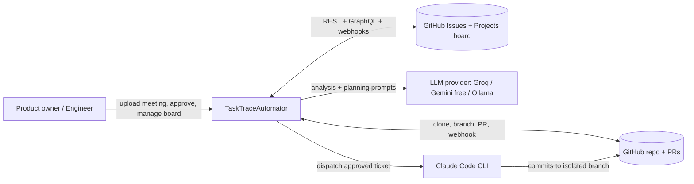
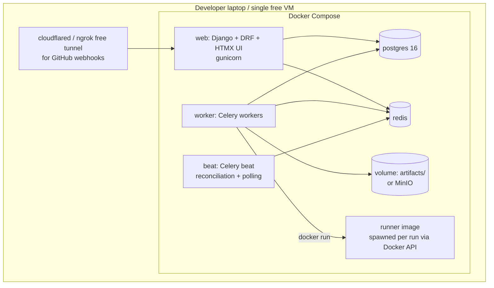
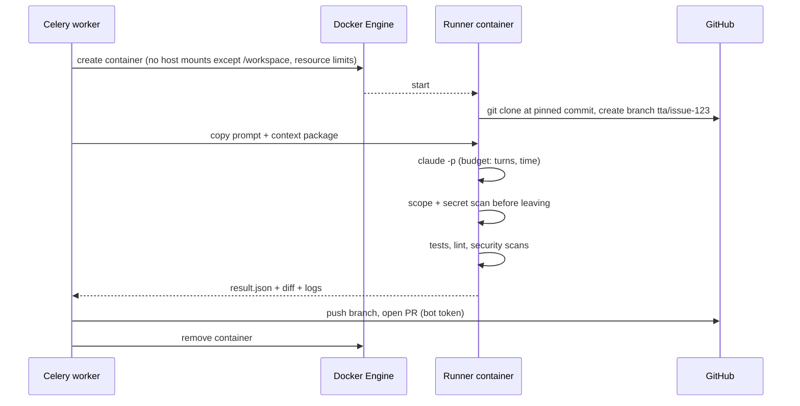
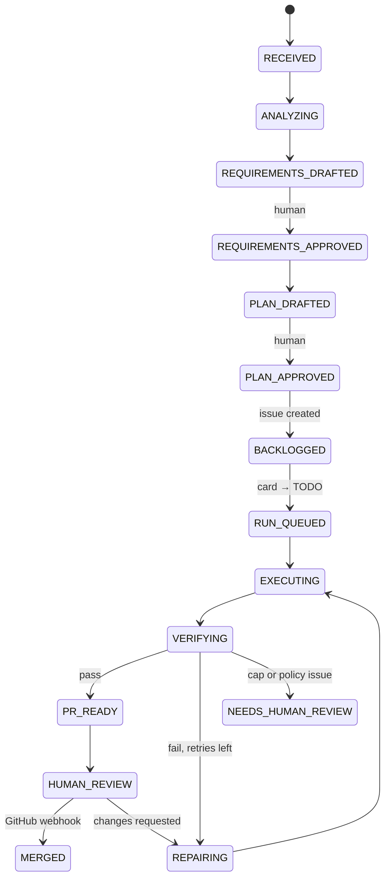

# TaskTraceAutomator — Architecture

**Reference:** [task_trace_automator_plan.md](task_trace_automator_plan.md) · High-level view: [task_trace_automator_hld.md](task_trace_automator_hld.md)
**Status:** Proposed architecture
**Cost principle:** Every component is free or open source and runs locally with Docker Compose. Paid services are optional and listed explicitly in section 12.

---

## 1. Goals and Scoping

The plan describes a production-grade platform. This document keeps the same core idea and workflow: meeting → requirements → plan → backlog tickets → Claude Code run → verification → PR. It makes the following trade-offs to stay free and buildable by a small team.

| Plan | This architecture | Reason |
|---|---|---|
| Jira as the ticket system | **GitHub Issues + GitHub Projects (kanban board)** | Free, same repo host as the code, no extra account. Users never open the tracker UI, so Jira's UI has no value here (see section 5.5) |
| Temporal durable workflows | **Celery + Redis + a persisted state machine in PostgreSQL** | Free and simple; durability comes from DB state and idempotency keys |
| S3 object storage | **Local filesystem / MinIO (free, optional)** | No cloud cost |
| Managed PostgreSQL | **PostgreSQL in Docker** | Free |
| Ephemeral hardened runners | **Docker container per run** | Free isolation |
| Paid transcription | **faster-whisper (local, open source)**; transcript upload is the primary path | Free |
| Hosted LLM only | **Pluggable provider: Groq / Gemini free tier / Ollama local** for Analyst and Planner | Free |
| Claude Code as Coding Agent | **Claude Code CLI in the runner container** (the only possibly paid piece) | Required by the plan; see section 12 for the fallback |
| Full observability stack | **Structured logs + Django admin + audit table** | Free, minimal |
| React SPA | **Django templates + HTMX + Tailwind (CDN)** | One codebase, no Node build |
| Multi-tenant orgs | **Single-tenant, project-level roles** | Out of MVP scope |

The MVP principle from the plan is kept: **one coding agent with staged responsibilities**, human approval gates, typed versioned artifacts, and no auto-merge.

---

## 2. System Context



TaskTraceAutomator owns artifacts, approvals, policies, runs, and evidence. GitHub owns ticket identity, board status, code, and PRs. Neither GitHub feature is the source of truth for the workflow itself.

---

## 3. Container / Deployment View

Everything runs on one machine with `docker compose up`.



| Service | Image / tool | Responsibility |
|---|---|---|
| web | Python 3.12, Django, DRF | REST API, board UI, approval endpoints, webhook receivers |
| worker | same image, Celery | All long-running work: ingest, analyze, plan, GitHub sync, run orchestration |
| beat | same image | Board reconciliation, stuck-run detection, retry sweeps |
| postgres | postgres:16 | State, artifacts (JSONB), audit log |
| redis | redis:7 | Celery broker and result backend, short locks |
| runner | custom image (git, Python/Node, Claude Code CLI, test tools) | Isolated workspace where the coding agent and verifier run |
| tunnel | cloudflared (free) or ngrok free | Exposes the webhook endpoint to GitHub during demos |

Webhooks need a public URL. If a tunnel is not available, the beat reconciliation job polls GitHub every 30–60 seconds. This is the fallback already required by the plan.

---

## 4. Logical Architecture

```mermaid
flowchart LR
    subgraph Presentation
        UI[TaskTrace board<br/>Django templates + HTMX]
        API[DRF REST API]
    end

    subgraph Application[Django apps]
        ACC[accounts]
        PRJ[projects]
        MTG[meetings]
        REQ[requirements]
        WI[work_items]
        RUNS[runs]
        VER[verification]
        INT[integrations]
        AUD[audit]
    end

    subgraph Orchestration
        SM[State machine service]
        TASKS[Celery tasks<br/>idempotent activities]
    end

    subgraph Agents
        MA[Meeting Analyst]
        PL[Planner]
        CB[Context Builder<br/>deterministic]
        CA[Coding Agent adapter<br/>Claude Code]
        VF[Verifier]
    end

    subgraph Adapters
        LLMA[LLM adapter]
        TRA[Transcription adapter]
        SCMA[Repository adapter: GitHub]
        TRK[Tracker adapter: GitHub Issues + Projects]
    end

    UI --> API
    API --> Application
    Application --> SM
    SM --> TASKS
    TASKS --> Agents
    Agents --> Adapters
    Application --> PG[(PostgreSQL)]
    TASKS --> PG
```



### Layering rules

1. Views and serializers contain no business logic. They call service functions in each app (`services.py`).
2. Services change state only through the state machine, which writes an audit event in the same DB transaction.
3. Celery tasks are thin: load the object, check the idempotency key, call a service, record the outcome.
4. Adapters are the only code that talks to the outside world. Each is behind a Python `Protocol` so it can be swapped or mocked in tests. The tracker adapter keeps Jira, Linear, or Plane possible later.

---

## 5. Component Design

### 5.1 Ingestion (`meetings`)
- Accepts pasted text, `.txt`, `.md`, `.vtt`, `.srt`, or audio.
- Normalizes into `TranscriptSegment` rows (speaker, start, end, text, offset) with a SHA-256 checksum.
- Audio goes through **faster-whisper** (`small` or `base` model, CPU) in a Celery task. Text input skips this step.
- Basic limits: file size cap, extension allow-list. A simple regex secret/PII redactor runs on the transcript.

### 5.2 Meeting Analyst (`agents/meeting_analyst`)
- One LLM call (or chunk-and-merge for long transcripts) with a JSON schema.
- Output validated with **Pydantic**; invalid output triggers one repair retry, then fails the task.
- Produces a `RequirementPackage` with decisions, goals, functional and non-functional requirements, constraints, open questions, and out-of-scope items. Each item carries `source_segment_ids` and a confidence value.
- No tools and no side effects. The transcript is passed as delimited, untrusted data.

### 5.3 Planner (`agents/planner`)
- Input: approved requirement package and repository profile.
- Output: `WorkItem` (Given/When/Then criteria, definition of done, test plan) and `ImplementationPlan` (allowed paths, protected paths, test commands, diff budget).
- **Plan changes:** compares a proposed revision with the approved plan, writes a `PlanChange` with a diff and a reason, and requests approval. Only an approved `PlanChange` produces a sub-issue.

### 5.4 Context Builder (`agents/context_builder`) — deterministic first
No embeddings in the MVP. It uses:
- `git ls-files`, `ripgrep` keyword search, and Python `ast` / `ctags` for symbols;
- Django route and model discovery (`urls.py`, `models.py`, `tests/`);
- recent-change heat from `git log --name-only`.

It outputs a `ContextPackage` with files to read, files allowed to change, protected files, and conventions. The engineer can edit the allow-list during plan review. `pgvector` is an optional later addition.

### 5.5 Tracker control plane (`integrations/github_tracker`)

**Why GitHub Issues + Projects instead of Jira.** Users work in the TaskTrace board, not in the tracker. The tracker only needs to store tickets, status, comments, assignees, labels, parent/child links, and emit events. GitHub covers all of that for free:

| Capability needed | GitHub equivalent | Notes |
|---|---|---|
| Backlog issue per work item | Issue (REST `POST /repos/{o}/{r}/issues`) | Body holds summary, criteria, plan version, work-item ID |
| Status columns (Backlog, TODO, In Progress, In Review, Blocked, Done) | Projects v2 single-select **Status** field | Changed via GraphQL `updateProjectV2ItemFieldValue` |
| Sub-task for a plan change | **Sub-issues** (parent/child issues) | Created via REST sub-issues endpoints |
| Comments | Issue comments (REST) | |
| Assign, labels, priority | Assignees, labels, custom **Priority** field | Priority is a Projects field |
| Block / unblock with reason | Status `Blocked` plus a comment, optional `blocked` label | Reason is stored in the comment and in the audit log |
| Event on move to TODO | Webhook `projects_v2_item` (edited) | **Organization-level webhook only** |
| Event on issue edits/comments | Webhooks `issues`, `issue_comment` | Repository level |
| Link PR and evidence | `Closes #n` in PR, plus a comment with the report | |

Differences that matter, and how they are handled:
- **No enforced workflow transitions.** GitHub lets anyone drag a card anywhere. TaskTraceAutomator validates every incoming status change against its own state machine, and reverts the card (with an explanatory comment) if the move is illegal. This is stricter than Jira's default setup, not weaker.
- **`projects_v2_item` webhooks exist only for organization-owned projects.** Use a free GitHub Organization for the project. If that is not possible, the beat job polls the project items through GraphQL. A `status:todo` label with the repository-level `issues` webhook is a second fallback.
- **Projects are configured through GraphQL.** The adapter hides this; it caches the Status field ID and option IDs per project.
- **Rate limits** (5,000 requests/hour per token) are ample at this volume. Calls are batched and conditional (`ETag`) where possible.

Behavior:
- Creates backlog issues after plan approval. Idempotent: key = `work_item_id + plan_version`, embedded as a hidden marker in the issue body; the issue number and project item ID are stored in `ExternalIssue`.
- UI commands (move, comment, assign, block/unblock) are authenticated TaskTraceAutomator endpoints. Each one calls GitHub and writes an audit event.
- Inbound webhooks are verified with the `X-Hub-Signature-256` HMAC, persisted to `WebhookEvent`, deduplicated by `X-GitHub-Delivery`, then processed.
- Beat reconciliation compares board state with internal state so missed deliveries cannot strand tickets.

### 5.6 Run orchestrator (`runs`)
Triggered when a managed issue or sub-issue enters **TODO**:
1. Verify the issue is in the configured project, links to an approved plan version, and has no active or completed run (unique constraint on `work_item + plan_version` for active runs).
2. Create `CodingRun`, move the card to **In Progress**.
3. Build or load the `ContextPackage`.
4. Launch the runner container (section 6).
5. Collect results, run verification, then open the PR or escalate.

### 5.7 Coding Agent adapter (`agents/coding_agent`)
- Calls **Claude Code CLI in headless mode** (`claude -p`) inside the runner with a generated prompt file built from the ticket, plan, context package, and path policy. The prompt keeps instructions separate from untrusted content.
- Limits: `--max-turns`, wall-clock timeout, and a token/cost cap via the run budget.
- Issue text is never fed to the agent directly. Only the internally approved plan version is used, as the plan requires.

### 5.8 Verifier (`verification` + runner)
Deterministic checks first, interpretation second. Free tools only:

| Check | Tool |
|---|---|
| Tests | project test command (pytest / npm test) |
| Lint / format | ruff, eslint |
| Types | mypy / pyright (if configured) |
| Static security | **bandit**, **semgrep (OSS rules)** |
| Dependency audit | **pip-audit** / `npm audit` |
| Secret scan | **gitleaks** |
| Scope check | `git diff --name-only` compared with allow-list and protected paths; diff-size cap |
| Traceability | each acceptance criterion mapped to a test id or explicit evidence in the report |

Result: `PASS`, `FAIL`, or `NEEDS_HUMAN_REVIEW`. On `FAIL` with retries left, structured failure feedback goes back to the same coding stage. Cap at 2 retries, then escalate.

### 5.9 Human Gate (`requirements`, `work_items`)
An `Approval` row stores user, artifact type, artifact id and version, decision, comment, and time. Approving a new version supersedes older approvals. Approval endpoints require the current version number and return 409 if it is stale.

### 5.10 Audit (`audit`)
Append-only `AuditEvent` table. The application DB role has `INSERT`/`SELECT` only on it. It records state transitions, approvals, board commands, webhooks received, prompts (hashed plus stored reference), tool results, diffs, and checks.

---

## 6. Execution Sandbox



Controls (all free, using Docker features):
- CPU, memory, and PID limits; read-only root filesystem with a writable `/workspace`.
- Non-root user; `--cap-drop ALL`; no Docker socket mounted into the runner.
- Network restricted to the Anthropic API, the GitHub host, and package registries via an egress proxy or Docker network allow-list (tinyproxy or squid).
- The GitHub token given to the runner is a **fine-grained PAT** limited to one repo with contents and pull-request write. Branch protection on `main` prevents merge without review, so the agent cannot merge.
- Scope is enforced **outside the model**: after the run the worker diffs against the allow-list and rejects violations regardless of what the agent claims.

---

## 7. State Machine

The state machine in section 9 of the plan is kept. It is implemented as:
- a `status` column on `Meeting`, `WorkItem`, and `CodingRun`;
- a `transition(obj, to_state, actor, command_id)` service that checks the allowed-transition table, enforces locking (`SELECT … FOR UPDATE`), writes the `AuditEvent`, and rejects a repeated `command_id` as a no-op;
- Celery tasks that are re-enqueued from the DB state, not from message content, so a worker crash resumes cleanly.



**Durability without Temporal:** use `acks_late=True`, `task_reject_on_worker_lost=True`, per-activity idempotency keys stored in an `ActivityLog` table (`key`, `status`, `result_ref`), and a beat job that re-enqueues runs stuck in a non-terminal state past a timeout. External side effects (create issue, open PR) check `ActivityLog` and the stored external reference before acting.

---

## 8. Data Architecture

### 8.1 Storage
| Data | Store |
|---|---|
| Domain objects, versions, approvals, audit | PostgreSQL |
| Evolving model output | JSONB columns, with hot fields promoted to columns |
| Recordings, large logs, patches, reports | Local volume `artifacts/` (path + SHA-256 in DB); MinIO is optional |
| Queue and locks | Redis |
| Search | PostgreSQL full-text search (no vector DB in MVP) |

### 8.2 Core tables
The ER model in section 10 of the plan applies. Additions:

| Table | Purpose |
|---|---|
| `ExternalIssue` | `work_item_id`, `plan_version`, `issue_number`, `issue_node_id`, `project_item_id`, `parent_issue_number`, `last_status`, `synced_at` |
| `PlanChange` | `implementation_plan_id`, `from_version`, `to_version`, `diff`, `reason`, `status`, `sub_issue_number` |
| `ActivityLog` | Idempotency keys for side-effecting tasks |
| `WebhookEvent` | Raw inbound event, delivery ID, signature result, processed flag |
| `ModelCall` | Provider, model, prompt version, tokens, latency, cost (zero for free tiers) |

### 8.3 Rules
- UUID public IDs; approved artifacts are immutable, and edits create a new version.
- Prompts, JSON schemas, and tool policies live in the repo with a version string; each artifact records the versions used.
- Secrets exist only in environment variables or Docker secrets (`.env` is git-ignored), never in artifacts or prompts.

---

## 9. API and UI

### 9.1 REST
Resources follow section 11.1 of the plan with tracker-neutral names:

```text
POST /api/implementation-plans/{id}/create-issues/
POST /api/plan-changes/{id}/approve/
POST /api/integrations/github/webhook/
POST /api/issues/{number}/transition/
POST /api/issues/{number}/comments/
POST /api/issues/{number}/sub-issues/
GET  /api/issues/{number}/timeline/
```

Conventions:
- DRF with `drf-spectacular` for free OpenAPI docs at `/api/docs/`.
- Token or session auth.
- Mutations accept an `Idempotency-Key` header; long operations return `202` with a run id and status URL.
- Project role check (`viewer`, `member`, `approver`, `admin`) in a DRF permission class.

### 9.2 UI (TaskTrace board)
Server-rendered Django templates with **HTMX** for partial updates and **Alpine.js / Tailwind via CDN**. No JS build chain.

| Screen | Content |
|---|---|
| Projects | Repo link, policy, test command, repo profile |
| Meeting review | Transcript with highlighted source spans, requirement items with edit, split, delete, approve |
| Plan review | Work items, acceptance criteria, allow-list editor, plan diff for changes |
| Board | Columns for Backlog, TODO, In Progress, In Review, Blocked, Done; actions to move, comment, assign |
| Run detail | Live status (HTMX polling every 3 s), logs, diff, verification report, PR link |
| Audit timeline | Filterable event list per work item |

---

## 10. Security and Governance

| Threat | Control |
|---|---|
| Prompt injection from transcript, code, or issue text | Untrusted content wrapped in delimited blocks; Analyst has no tools; coding agent only receives approved plan; scope enforced after the run |
| Secret leakage | gitleaks before push; regex redaction on transcripts and logs; secrets only in env |
| Agent edits protected files | Post-run diff check against path policy; failure blocks PR |
| Unauthorized actions | DRF permissions, approval-version checks, HMAC-verified webhooks |
| Illegal board moves made directly on GitHub | State machine validates and reverts the card |
| Duplicate or replayed commands | Idempotency keys, unique constraints, `WebhookEvent` dedupe by delivery ID |
| Runaway cost or time | Per-run budget (turns, time, tokens), retry cap of 2 |
| Auto-merge | Not possible: bot token has no merge rights, `main` is branch-protected |
| Provider data exposure | Provider choice per project; a local Ollama option keeps data on the machine |

Documented but not built in the first version: multi-tenant isolation, KMS, formal retention workflows.

---

## 11. Observability and Testing

### Observability (free)
- Structured JSON logs (`structlog`) with `run_id`, `work_item_id`, and `command_id` on every line.
- Django admin as the operations console.
- `ModelCall` and `CodingRun` tables supply cost, latency, and failure-category numbers for evaluation.
- Optional: Prometheus + Grafana containers.

### Testing strategy
| Level | Tooling |
|---|---|
| Unit | pytest, pytest-django |
| Adapter contract tests | Recorded HTTP with `responses` or `vcr.py`, mocks for GitHub and LLM |
| State machine tests | Table-driven transition and idempotency tests |
| Workflow tests | Kill worker mid-run, duplicate webhook, delayed webhook, illegal card move |
| Agent evaluation | Small fixed set of 5–10 meetings with expected requirements, and 5–10 repo tasks, scored per the plan's metrics |
| Security | Injection fixtures in transcripts and repo files; assert the scope guard blocks them |
| CI | **GitHub Actions free tier**: lint, tests, bandit, gitleaks |

---

## 12. Technology Stack and Cost

| Concern | Choice | Cost |
|---|---|---|
| Language / framework | Python 3.12, Django 5, Django REST Framework | Free |
| Database | PostgreSQL 16 | Free |
| Queue / workers | Celery + Redis | Free |
| Validation | Pydantic v2 for LLM outputs | Free |
| UI | Django templates, HTMX, Alpine.js, Tailwind (CDN) | Free |
| Transcription | faster-whisper (local) | Free |
| LLM for Analyst and Planner | Groq free tier, Google Gemini free tier, or Ollama (Llama 3.x / Qwen) locally, behind one adapter | Free |
| Coding agent | **Claude Code CLI** | **Possibly paid** (see below) |
| Ticketing / kanban | GitHub Issues + Projects v2 (free organization recommended for webhooks) | Free |
| Source control / PR | GitHub + fine-grained PAT, Actions free tier | Free |
| Sandbox | Docker Engine / Docker Desktop (personal use) | Free |
| Webhook tunnel | cloudflared or ngrok free | Free |
| Security scans | bandit, semgrep OSS, gitleaks, pip-audit | Free |
| Deployment | Docker Compose on laptop; optional free VM (Oracle Cloud Always Free) | Free |
| API docs | drf-spectacular | Free |

**The one cost to plan for:** Claude Code needs either a Claude subscription that includes it or API credits. To keep spend minimal:
- limit demos to small tasks with `--max-turns` and a per-run token cap;
- use the cheapest suitable model for the coding stage;
- cache the context package so retries do not re-run analysis.

**Free fallback:** because the Coding Agent is behind an adapter, a free alternative (for example **Aider** or **OpenHands** pointed at a free Gemini or Groq key, or a local Ollama model) can be dropped in with the same contract: input is a prompt file and workspace, output is a diff and `result.json`. Quality will be lower, but the entire pipeline stays at zero cost.

---

## 13. Repository Layout

```text
task-trace-automator/
├── docker-compose.yml
├── .env.example
├── Dockerfile                  # web/worker image
├── runner/
│   ├── Dockerfile              # git, python, node, claude CLI, scanners
│   └── entrypoint.sh           # clone, branch, run agent, scan, emit result.json
├── config/                     # settings, urls, celery.py
├── apps/
│   ├── accounts/  projects/  meetings/  requirements/
│   ├── work_items/  runs/  verification/  integrations/  audit/
├── agents/
│   ├── meeting_analyst/  planner/  context_builder/  coding_agent/
├── providers/                  # llm/, transcription/, repository/, tracker/
├── schemas/                    # JSON/Pydantic artifact contracts
├── prompts/                    # versioned stage prompts
├── templates/  static/         # HTMX UI
├── tests/
│   ├── unit/  integration/  workflow/  evaluation/
└── docs/
    └── architecture/
```

---

## 14. Build Order

| Phase | Deliverable | Exit check |
|---|---|---|
| 0. Foundation | Compose stack, Django apps, models, audit, state machine, auth | Transitions are tested and idempotent |
| 1. Understand | Transcript upload, Analyst, requirement review UI, approvals | A draft package is corrected and approved |
| 2. Plan | Planner, Context Builder, plan review with allow-list, plan versions | Reviewer can see why each file is in scope |
| 3. Tracker | Issue creation, board UI, webhook and reconciliation, `PlanChange` sub-issues | Moving a card to TODO creates a queued run exactly once |
| 4. Build and verify | Runner image, Claude Code adapter, scope enforcement, scanners, report, PR creation | A bad run (out-of-scope edit) is blocked; a good run opens a PR |
| 5. Hardening | Retry cap, crash recovery, duplicate and delayed webhook tests | Restarting a worker mid-run does not duplicate issues or PRs |
| 6. Evaluation | Run fixed evaluation set, collect metrics | Report compares the staged agent against a manual baseline |

**Cut line if time is short:** drop audio transcription, the MinIO option, Prometheus and Grafana, and the free-fallback coding agent. Keep the transcript → requirements → plan → issue → Claude Code → verified PR path with human gates.

---

## 15. Risks Specific to This Architecture

| Risk | Mitigation |
|---|---|
| Celery lacks Temporal-style replay | Persisted state machine, `ActivityLog` idempotency, reconciliation beat job, crash tests |
| Free LLM tiers rate-limit or produce weaker JSON | Pydantic validation with one repair retry, chunking, provider fallback chain, small transcripts for demos |
| Webhooks unreachable on a laptop | Free tunnel plus polling reconciliation |
| `projects_v2_item` webhook unavailable for personal accounts | Use a free organization, or fall back to GraphQL polling |
| GitHub lets users move cards illegally | State machine validates every change and reverts the card |
| Docker sandbox weaker than a hardened runner | No host mounts, dropped capabilities, egress allow-list, scoped PAT, protected `main` |
| Claude Code cost | Budget caps, small tasks, adapter fallback |
| Scope creep toward multi-agent | Single-agent baseline first; specialists only after measured benefit, per the plan |
