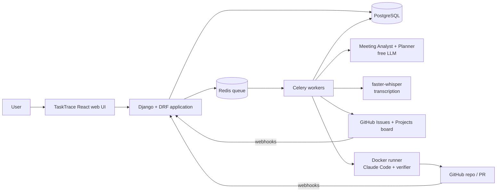
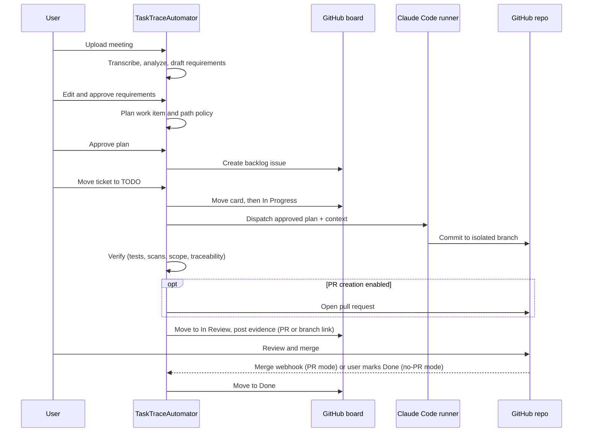

# TaskTraceAutomator — High-Level Design (HLD)

**Related:** [Plan](task_trace_automator_plan.md) · [Detailed architecture](task_trace_automator_architecture.md)
**Audience:** Product owner, engineers, reviewers who need the system on one page.

---

## 1. Purpose

TaskTraceAutomator turns a meeting into a reviewed, verified pull request with every step traceable and every consequential step approved by a human.

```text
Meeting  →  Requirements  →  Plan  →  Board ticket  →  Coding run  →  Verification  →  Pull request (optional) / branch
              (approve)     (approve)    (move to TODO)                                   (human review)
```

## 2. Scope

**In scope**
- Transcript or audio input, requirement extraction, plan and work-item generation.
- Automatic creation of tickets on a GitHub Projects kanban board, with plan changes as sub-issues.
- A TaskTrace board UI so users never need to open the tracker directly.
- Automatic Claude Code run when a ticket moves to TODO, in an isolated container.
- Automated verification, a traceability report, and a branch handoff for human review. A GitHub PR is a good-to-have (per-project `create_pull_request` setting, default off).

**Good-to-have** (not needed for the MVP): GitHub PR creation, audio transcription, MinIO storage, Prometheus/Grafana, free fallback coding agent, pgvector retrieval, other trackers (Jira, Linear, Plane), specialist agents, hosted deployment. See `implementation_plan/plan.md` §9.
- Full audit trail.

**Out of scope**
- Auto-merge or deployment.
- Live meeting bots.
- Multi-repo runs, multi-tenant administration.
- Multiple specialist coding agents (only after a measured benefit).

## 3. Key Design Decisions

| # | Decision | Why |
|---|---|---|
| 1 | One coding agent with staged responsibilities | Establish a baseline before adding complexity |
| 2 | Typed, versioned artifacts instead of chat history | Auditable, resumable, reviewable |
| 3 | Human approval at requirements, plan, plan changes, and final review (PR if enabled, otherwise branch diff) | Intent and code stay human-accountable |
| 4 | GitHub Issues + Projects as the ticket system | Free, one platform with the code, and it covers backlog, status, comments, sub-issues, assignees, and webhooks. Users see the TaskTrace board, not the tracker |
| 5 | Persisted state machine + Celery/Redis | Durable and free; replaces a workflow engine |
| 6 | Scope and security enforced outside the model | The model is not trusted to police itself |
| 7 | Adapters for LLM, transcription, repo, tracker, coding agent | Every external dependency can be swapped or mocked |
| 8 | Free and open-source stack | Only Claude Code may cost money |

## 4. System Overview



## 5. Major Components

| Component | Role |
|---|---|
| **Web UI (React SPA)** | Meeting review, plan review, kanban board, run detail, audit timeline; talks only to the REST API |
| **API (Django + DRF)** | REST API with approvals and idempotency keys; the OpenAPI schema generates the UI's typed client |
| **Meeting Analyst** | Extracts decisions, requirements, constraints, risks, open questions with source references |
| **Planner** | Produces work items, acceptance criteria, test plan, path policy; proposes plan changes |
| **Context Builder** | Deterministic selection of relevant files, allowed and protected paths |
| **Tracker adapter** | Creates issues and sub-issues, moves cards, comments, reconciles status |
| **Run orchestrator** | Starts exactly one run per approved ticket on TODO, manages retries and escalation |
| **Coding agent runner** | Claude Code in an isolated Docker container with budgets |
| **Verifier** | Tests, lint, security and secret scans, scope check, acceptance-criteria traceability |
| **Human gate** | Records versioned approvals; stale approvals are rejected |
| **Audit log** | Append-only record of transitions, commands, webhooks, prompts, diffs, and checks |

## 6. End-to-End Flow



**Plan change after approval:** Planner writes a new plan version and a diff, a human approves it, and a sub-issue is created under the parent ticket. It runs only when the sub-issue itself reaches TODO.

## 7. Workflow States

```text
RECEIVED → ANALYZING → REQUIREMENTS_DRAFTED → REQUIREMENTS_APPROVED
→ PLAN_DRAFTED → PLAN_APPROVED → BACKLOGGED → RUN_QUEUED → EXECUTING
→ VERIFYING → PR_READY → HUMAN_REVIEW → MERGED

VERIFYING → REPAIRING → EXECUTING        (max 2 retries)
VERIFYING → NEEDS_HUMAN_REVIEW           (retry cap or policy violation)
```

Every transition is idempotent, locked, and written to the audit log. Illegal card moves made directly on GitHub are reverted.

## 8. Data Overview

| Group | Entities |
|---|---|
| Input | Project, Meeting, MeetingSource, TranscriptSegment |
| Understanding | RequirementPackage, RequirementItem, Approval |
| Planning | WorkItem, ImplementationPlan, PlanChange, ContextPackage |
| Execution | CodingRun, VerificationReport, ActivityLog |
| Integration | ExternalIssue, WebhookEvent |
| Governance | AuditEvent, ModelCall |

PostgreSQL holds structured data and JSONB artifacts. Large files (recordings, logs, patches) sit on a local volume or MinIO with checksums in the database.

## 9. Technology Summary

| Layer | Choice |
|---|---|
| Backend | Python, Django, Django REST Framework, Pydantic |
| Async | Celery, Redis |
| Data | PostgreSQL |
| UI | React 18, TypeScript, Vite, TanStack Query, Tailwind CSS, dnd-kit; served by nginx |
| AI | Free LLM tier (Groq / Gemini) or Ollama; faster-whisper; Claude Code CLI for coding |
| Tracker and repo | GitHub Issues, Projects v2, Pull Requests, Actions |
| Sandbox | Docker |
| Verification | pytest, ruff, bandit, semgrep, gitleaks, pip-audit |
| Deployment | Docker Compose; free tunnel for webhooks |

## 10. Security Summary

- Meeting text, repo files, and issue text are treated as untrusted data.
- The coding agent receives only the approved plan, never raw issue text.
- Path allow-list and protected paths are enforced after the run, outside the model.
- Runner has no host mounts, dropped capabilities, restricted network, and a repo-scoped token without merge rights; `main` is branch-protected.
- Webhooks are HMAC-verified and deduplicated.
- Budgets cap turns, time, tokens, diff size, and retries.

## 11. Non-Functional Targets

| Area | Target |
|---|---|
| Recoverability | Worker restart or duplicate webhook never creates duplicate issues, runs, or PRs |
| Traceability | Every requirement, criterion, test, and diff is linked back to its source |
| Safety | Zero out-of-scope changes reach review |
| Cost | Free infrastructure; bounded Claude Code spend per run |
| Usability | Users complete the whole flow from the TaskTrace UI without opening GitHub Projects |

## 12. Risks (Summary)

| Risk | Mitigation |
|---|---|
| Weak free-LLM output | Schema validation, repair retry, chunking, provider fallback |
| Webhooks unavailable locally | Free tunnel and polling reconciliation |
| `projects_v2_item` webhooks need an organization | Use a free GitHub organization, or poll via GraphQL |
| Claude Code cost | Budgets, small tasks, swappable agent adapter |
| Scope creep to multi-agent | Baseline first, specialists only on evidence |

## 13. Delivery Phases

1. Foundation: models, state machine, audit, auth.
2. Understand: transcript, Analyst, requirement review.
3. Plan: Planner, Context Builder, plan review.
4. Tracker: GitHub board integration, webhooks, plan-change sub-issues.
5. Build and verify: runner, Claude Code, verification, PR.
6. Hardening: retries, crash and duplicate-event tests.
7. Evaluation: fixed test set against a manual baseline.
