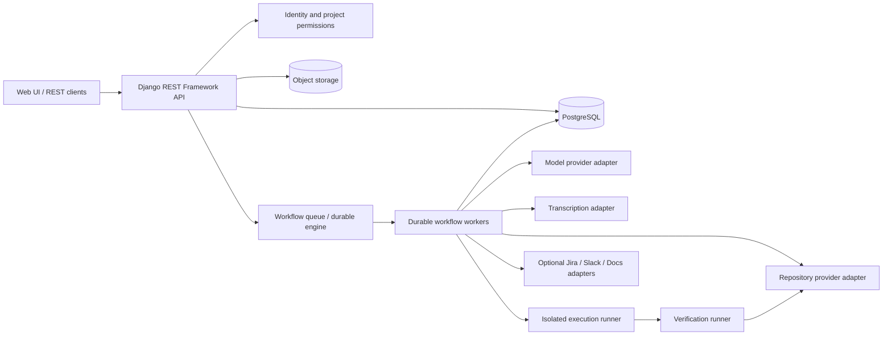
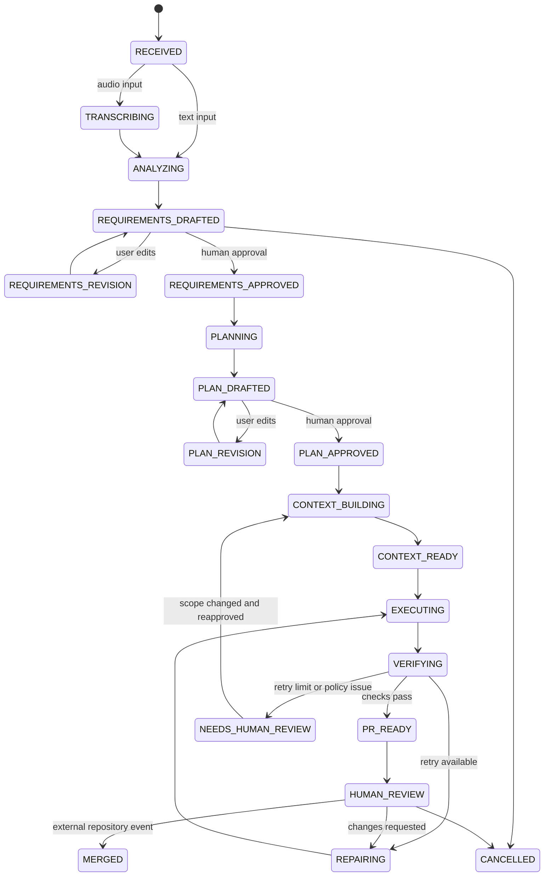
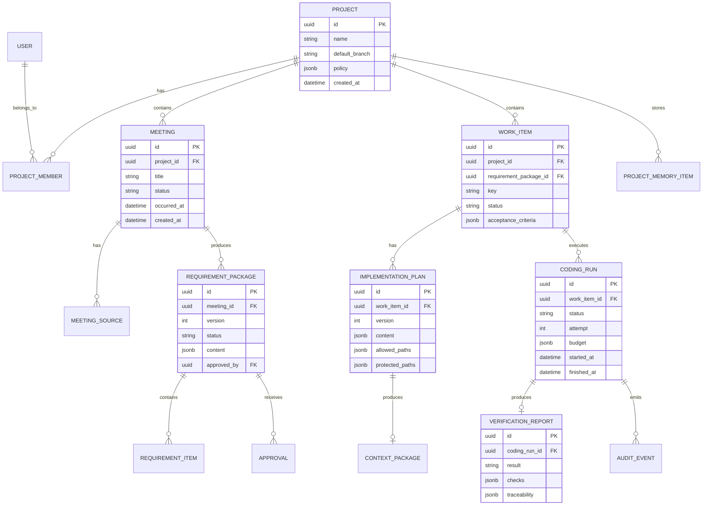
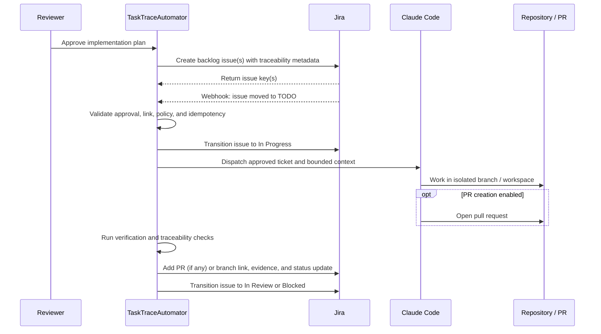

# TaskTraceAutomator

## Product and Architecture Document

**Working product identity:** TaskTraceAutomator — an AI-assisted, traceable workflow from meeting decisions to Jira tickets and reviewable code changes.

**Status:** Proposed architecture  
**Primary audience:** Product owner, engineering team, technical stakeholders  
**Target implementation:** Django REST Framework, PostgreSQL, durable workflow orchestration  
**MVP principle:** One coding agent with staged responsibilities; specialist agents are an evidence-based extension, not a prerequisite

---

## 1. Executive Summary

TaskTraceAutomator converts a product or engineering conversation into an auditable, reviewable software change. A user uploads or records a meeting, adds optional project context, reviews the extracted requirements, and approves a generated implementation plan. The platform then creates Jira backlog tickets, waits for an approved ticket to enter TODO, automatically dispatches the ticket to Claude Code, prepares bounded coding context, verifies the resulting changes, and produces a pull request or implementation package for human review.

The product is not primarily an artificial “engineering team.” The team-like roles are an implementation pattern used to make one reliable workflow understandable and governable:

1. **Meeting Analyst:** extracts decisions, requirements, constraints, risks, and unanswered questions.
2. **Planner:** turns approved requirements into a small, testable implementation plan.
3. **Coding Agent:** implements the plan in a controlled workspace.
4. **Verifier:** runs tests and policy checks and reports evidence.

In the MVP, these are staged responsibilities of one coding agent and a durable orchestrator. The platform should only split responsibilities into separate specialist agents when evaluation demonstrates a measurable improvement in quality, safety, cost, or throughput.

The central design decision is to preserve intent and context between stages through typed artifacts rather than relying on a long conversational prompt. Every stage produces a versioned artifact, every transition is durable and auditable, and human approval is required before ambiguity or code changes become consequential.

---

## 2. Problem Statement

### 2.1 Product conversations contain valuable intent but poor implementation structure

Meetings are where teams discuss goals, user pain, priorities, constraints, edge cases, and trade-offs. The resulting recording or transcript is usually not an implementation-ready specification. Important information is mixed with:

- background discussion and repetition;
- tentative ideas that were never approved;
- decisions that lack an explicit owner;
- technical constraints mentioned informally;
- unresolved questions;
- references to existing screens, APIs, tickets, or code;
- assumptions that are obvious to participants but invisible to an AI system.

The usual handoff from meeting to development is manual: someone writes notes, creates tickets, explains the decision again, and answers follow-up questions. Meaning is lost at each step.

### 2.2 Natural-language coding is fast at the beginning and fragile at the boundaries

Prompt-driven coding can produce a prototype quickly, but the difficult work is usually the last part:

- translating ambiguous intent into precise behavior;
- identifying all affected modules and data flows;
- preserving existing architecture and conventions;
- handling permissions, failures, and backward compatibility;
- writing tests that prove the requirements;
- keeping the change small enough to review;
- preventing a fix from breaking another feature.

Without a structured workflow, an AI coding tool may make plausible but unsafe assumptions, modify unrelated files, omit tests, or repeatedly patch symptoms without resolving the underlying issue.

### 2.3 Existing team workflows are fragmented

The source material describes a pipeline spanning requirements, architecture, execution, testing, and review. That approach is directionally useful, but it places too much emphasis on a permanent collection of specialist agents before the core product has been validated. The first product should validate the more important hypothesis:

> Can a meeting, together with a bounded project context, reliably produce an approved, testable, reviewable code change?

Specialist agents can be introduced later if measurements show that a single staged agent is insufficient.

### 2.4 Business impact

If the problem remains unsolved, teams experience:

- slower time from decision to working software;
- repeated clarification meetings;
- inconsistent requirements and architecture;
- oversized or difficult-to-review pull requests;
- regression bugs and incomplete acceptance criteria;
- weak traceability from business intent to code and tests;
- avoidable security, privacy, and operational risk.

The platform must improve the handoff without encouraging teams to remove human accountability from product or code decisions.

---

## 3. Proposed Solution

Meeting-to-Code is a governed workflow product with five visible phases:

```text
Meeting input
    ↓
Understand: transcript → decisions, requirements, questions
    ↓ human approval
Plan: approved requirements → implementation plan and test plan
    ↓ human approval
Build: bounded context → coding agent changes in an isolated workspace
    ↓ automated verification
Review: evidence, diff, and traceability → pull request / handoff
```

### 3.1 Product promise

For a small, well-scoped change, a user should be able to move from “we discussed this in a meeting” to “here is an auditable pull request with tests and evidence” without manually recreating the conversation for an engineering tool.

### 3.2 What the product does

- Accepts a transcript, audio recording, notes, or pasted meeting content.
- Identifies participants, topics, decisions, requirements, constraints, risks, and open questions.
- Links extracted items to source transcript segments where possible.
- Lets a human edit and approve the structured requirement package.
- Creates a small implementation plan for an existing repository or a greenfield starter project.
- Builds a bounded context package containing only relevant files, conventions, contracts, and constraints.
- Runs one coding agent in an isolated branch or workspace.
- Runs tests, linting, security checks, and scope checks.
- Maps acceptance criteria to tests and verification evidence.
- Optionally opens a GitHub pull request for human review (configurable per project); when disabled, hands off the branch, diff, and verification report instead.
- Provides a Jira-backed workflow UI so users can manage approved work without opening Jira; backlog items and plan-change sub-tasks are created automatically, while status changes and comments are optional human actions.
- Stores the workflow history and artifacts for later audit and learning.

### 3.3 What the product does not do in the MVP

- Autonomously merge code into the default branch.
- Treat a transcript as an approved specification.
- Run an unrestricted coding agent against an entire repository.
- Promise production-ready code without human review.
- Coordinate five independent coding agents before a single-agent baseline exists.
- Replace product ownership, engineering judgment, or security review.

---

## 4. Project Overview

### 4.1 Primary users

| User | Need | Primary interaction |
|---|---|---|
| Product owner | Turn a conversation into an accurate, actionable change | Upload meeting, edit requirements, approve scope |
| Engineering lead | Ensure the plan fits the repository and is safe to execute | Review context, constraints, and implementation plan |
| Developer | Receive a focused change with evidence instead of repeating the meeting | Review plan, inspect diff, revise or merge PR |
| Engineering manager | Understand throughput, quality, cost, and failure modes | Review workflow history and metrics |
| Security or compliance reviewer | Verify governance and traceability | Inspect audit trail, permissions, findings, and approvals |

### 4.2 Core domain objects

The product revolves around a `Project`, a `Meeting`, a `RequirementPackage`, a `WorkItem`, an optional `ExternalIssue` link, a `ContextPackage`, a `Run`, and a `VerificationReport`. These objects are immutable or versioned where auditability matters. A work item stores its Jira issue key, synchronization state, and last observed status without making Jira the internal source of truth.

### 4.3 Product boundary

The platform owns orchestration, structured artifacts, approvals, execution controls, verification, and integrations. It does not own the customer’s source of truth for code, issue tracking, identity, or deployment. Adapters connect those systems while the platform maintains a normalized internal model.

---

## 5. User Workflow

### 5.0 TaskTraceAutomator as the Jira control plane

TaskTraceAutomator is the primary user interface for the approved Jira workflow. After a human approves a plan generated from meeting notes, the Planner Agent automatically creates the Jira backlog issue. If the approved plan later changes, the Planner Agent automatically creates a Jira sub-task for that change. From the TaskTraceAutomator UI, an authorized human can perform optional workflow actions without visiting the Jira workspace:

- move issues between configured statuses such as Backlog, TODO, In Progress, In Review, Blocked, and Done;
- add, edit, and view comments;
- block or unblock work with a reason;
- view automatically created Jira sub-tasks for plan changes and approve their execution;
- assign work, set priority, add labels, and update permitted fields;
- view the Jira issue key, status, history, linked pull request, run status, and verification evidence.

Each UI action is an authenticated TaskTraceAutomator command. The backend applies the corresponding Jira API operation, stores the result and external reference, and records an audit event. Jira webhooks and reconciliation remain enabled so changes made directly in Jira, automation rules, or other integrations are reflected back in TaskTraceAutomator. The UI should clearly show synchronization failures and provide a safe retry action.

This UI is a focused **TaskTrace board**, not a replacement issue-tracking product. It should expose only the Jira workflow fields and actions needed by this platform. Jira remains the backend issue system for ticket identity, status, comments, sub-task relationships, and external integrations.

### 5.1 Create a project

1. The user creates a project and selects a repository provider or uploads a repository reference.
2. The user configures the default branch, language, test command, coding conventions, and approval policy.
3. The platform performs a read-only repository scan to build a lightweight project profile.
4. The user confirms the profile and marks the project ready for a meeting.

### 5.2 Submit a meeting

1. The user uploads an audio file, transcript, meeting notes, or a link from a supported source.
2. The platform records provenance, access permissions, and retention settings.
3. Audio is transcribed when required. Existing transcripts remain associated with their source.
4. The Meeting Analyst produces a draft requirement package.

### 5.3 Review extracted intent

The review screen separates facts from interpretation:

- **Decisions:** statements that appear to have been agreed.
- **Goals:** desired outcomes and user value.
- **Functional requirements:** behaviors the system should support.
- **Non-functional requirements:** performance, availability, accessibility, security, privacy, and operational expectations.
- **Constraints:** existing APIs, data models, libraries, timelines, or policies.
- **Open questions:** ambiguities that must not be silently guessed.
- **Out of scope:** topics mentioned but intentionally excluded.

Each item should show a source excerpt or timestamp when available. The user can edit, delete, split, or add items. No code run can begin until the requirement package is approved.

### 5.4 Approve a work item

The Planner converts the approved package into one or more small work items. Each work item contains:

- a concise outcome;
- acceptance criteria in Given/When/Then form;
- edge cases and error behavior;
- affected areas and dependencies;
- an explicit definition of done;
- a proposed test plan;
- unresolved questions, if any.

The user chooses one work item for the MVP run. A work item with unresolved blocking questions cannot advance to execution.

### 5.5 Review the implementation plan

The Planner or Context Builder proposes:

- files and symbols to inspect;
- files allowed to change;
- files and systems protected from change;
- existing components to reuse;
- API and database contract changes;
- test locations and commands;
- security and privacy considerations;
- expected diff size and execution budget.

The engineering lead can adjust the allow-list and plan before approving it.

### 5.6 Create Jira backlog tickets after plan approval

When a human approves the implementation plan, the Planner Agent automatically creates one or more Jira issues in the configured project backlog. Jira is the execution queue for approved work, while TaskTraceAutomator remains the source of truth for artifact versions, approvals, context policy, agent runs, and verification evidence. No human Jira visit is required for issue creation.

Each Jira issue should include the approved work-item summary, acceptance criteria, definition of done, dependencies, approved paths, test commands, the TaskTraceAutomator work-item ID, and the immutable plan version. Ticket creation must be idempotent: the platform stores the Jira issue key as a durable external reference so retries cannot create duplicates.

### 5.6.1 Handle modifications to the approved plan as Jira sub-tasks

The original approved plan is immutable. If the Planner Agent or a human reviewer identifies any modification after approval—such as new scope, changed acceptance criteria, additional files, a new dependency, altered API or database behavior, or a new test requirement—the Planner Agent must create a new plan revision and represent the change as a Jira **sub-task** under the original Jira issue.

The Planner Agent must not silently rewrite the parent ticket or fold the change into the existing coding run. For every modification it should:

1. compare the proposed plan with the approved plan version;
2. explain the difference and why it is required;
3. create a versioned `PlanChange` / sub-task artifact linked to the parent work item;
4. request human approval when the change affects scope, risk, permissions, contracts, or protected paths;
5. create the Jira sub-task only after the revised plan is approved;
6. include the parent issue key, original plan version, new plan version, changed paths, acceptance criteria, and test evidence requirements;
7. keep the sub-task blocked until its own approved plan is ready for execution.

The parent ticket remains the source of the original scope. The Planner Agent automatically creates the sub-task after the revised plan is approved; the user does not manually create it in Jira. The sub-task is independently traceable and may be dispatched to Claude Code only when the sub-task itself moves to **TODO**. If the modification invalidates the parent run, the platform pauses the parent issue and marks it **Needs Approval** rather than starting parallel work automatically.

### 5.7 Run the coding stage when Jira moves the ticket to TODO

The user can move the issue to **TODO** from the TaskTraceAutomator UI. The backend performs the Jira transition and records the command. The Jira integration also listens for issue-transition webhooks, with reconciliation polling as a fallback, so a transition made elsewhere behaves consistently. When a managed issue moves to **TODO**, the platform verifies that the issue belongs to the configured project, references an approved plan, and has no active or completed coding run. It then starts a durable coding run and transitions the issue to **In Progress**.

Claude Code automatically pulls the approved ticket context through the Coding Agent adapter, checks out the approved repository ref, and works in an isolated branch or workspace with the approved path policy and execution budgets. The run must post its status and external run ID back to Jira. Arbitrary text added to a Jira issue must not override the internally approved plan.

The Coding Agent works in an isolated workspace with:

- the approved work item;
- the context package;
- repository conventions;
- relevant source files;
- explicit allowed and protected paths;
- a test-first or test-alongside instruction;
- tool and time budgets.

The agent must report assumptions and cannot broaden scope silently. If it needs additional context or a contract change, it pauses and requests approval.

### 5.8 Review evidence and pull request

The Verifier produces a report containing:

- tests run and results;
- lint and type-check results;
- security and secret-scan results;
- changed-file scope comparison;
- acceptance-criteria traceability;
- assumptions and warnings;
- cost and duration;
- final diff summary.

Opening a GitHub pull request is **optional** and controlled by a per-project setting (`create_pull_request`). When enabled, the user reviews the diff and report, requests changes, or approves the pull request for normal repository review. When disabled, the platform pushes (or retains) the isolated branch and presents the diff and verification report as the review handoff; the user may open a pull request manually. The platform never merges automatically in the MVP.

The Jira lifecycle should be configurable but follow this default:

```text
Backlog -> TODO -> In Progress -> In Review -> Done
                     \-> Blocked / Needs Approval
```

**In Review** requires a verification report and a reviewable handoff: a pull request when PR creation is enabled, otherwise the branch and diff. **Done** requires the normal repository review outcome; it must not be set merely because Claude Code generated a diff.

---

## 6. Architecture

### 6.1 Architectural principles

1. **Artifacts over chat history:** stages exchange typed, versioned artifacts.
2. **Human approval at consequential boundaries:** requirements, plan, and final code remain reviewable.
3. **Durable execution:** a crashed process must be resumable without losing state or duplicating side effects.
4. **Least privilege:** each integration and execution run receives only the access it needs.
5. **Bounded context:** the agent sees the smallest useful slice of a repository.
6. **Evidence before trust:** quality claims are based on tests, scans, scope checks, and traceability.
7. **Single-agent baseline first:** specialization is introduced only after comparison against a measured baseline.
8. **Adapter-based integrations:** repositories, meeting sources, issue trackers, and model providers can change independently.

### 6.2 Logical architecture



### 6.3 Recommended deployment shape

The initial deployment can be a small set of independently scalable processes:

- **Web/API process:** Django, Django REST Framework, authentication, project management, artifact APIs, approval endpoints.
- **Workflow worker process:** durable activities for ingestion, analysis, planning, context building, execution, and verification.
- **Execution runner:** isolated containers or ephemeral workers for repository checkout and Coding Agent execution.
- **PostgreSQL:** transactional state, workflow metadata, structured artifacts, audit events, and optional vector search via `pgvector`.
- **Object storage:** recordings, transcripts, large logs, patches, and generated reports.
- **Observability stack:** structured logs, metrics, traces, and cost telemetry.

The exact durable workflow engine may be Temporal or an equivalent system. A Celery-based implementation is possible, but the system must persist explicit workflow state, idempotency keys, retry history, and activity outcomes; a queue alone is not sufficient for durable business workflows.

### 6.4 Django REST Framework responsibilities

DRF is the synchronous application boundary. It should:

- authenticate users and service integrations;
- enforce project-level permissions;
- validate request payloads with serializers;
- create and version domain objects;
- expose workflow status and artifacts;
- accept approval and revision commands;
- enqueue or signal durable workflows;
- return stable API representations;
- expose health and readiness endpoints.

Long-running work must not execute inside a request. The API creates a command or workflow request and returns a run identifier.

---

## 7. Components

### 7.1 Ingestion service

Responsibilities:

- accept transcript, audio, notes, or external-source references;
- validate file type, size, and malware-scan status;
- normalize text while preserving source offsets or timestamps;
- store immutable source content and provenance;
- invoke transcription only when necessary;
- redact or classify sensitive content according to project policy.

Output: a versioned `MeetingSource` and normalized transcript segments.

### 7.2 Meeting Analyst

Responsibilities:

- summarize the meeting without treating every statement as a decision;
- extract goals, requirements, constraints, risks, and questions;
- identify conflicting statements;
- distinguish confirmed decisions from suggestions;
- attach confidence and source references;
- produce schema-valid JSON;
- avoid external side effects.

Output: a draft `RequirementPackage`.

### 7.3 Planner

Responsibilities:

- turn approved requirements into small work items;
- write acceptance criteria and test cases;
- identify dependencies and affected domains;
- prepare a proposed implementation plan;
- compare proposed changes with the immutable approved plan and create Jira sub-task proposals for modifications;
- state what the plan does not cover.

Output: `WorkItem` and `ImplementationPlan` artifacts.

### 7.4 Context Builder

Responsibilities:

- inspect repository metadata, symbols, imports, routes, models, and tests;
- identify relevant files and existing components to reuse;
- load approved conventions and architecture decisions;
- produce a read/modify/protected path policy;
- create a compact context package;
- detect when the requested change lacks sufficient repository context.

The context builder may begin with deterministic signals such as changed-history analysis, route maps, import graphs, and keyword search. Embedding search is useful later but must not be the only selection mechanism.

### 7.5 Coding Agent runner

Responsibilities:

- create an isolated branch or workspace;
- mount only approved inputs and tools;
- run the Coding Agent with explicit budgets;
- capture tool calls, output, changed files, and status;
- enforce path and diff policies outside the model prompt;
- stop on policy violation, timeout, or budget exhaustion;
- return a structured run result.

### 7.6 Verifier

Responsibilities:

- run the project’s test command;
- run linting and type checks where configured;
- run secret, dependency, and static security scans;
- enforce changed-file scope;
- compare the diff with the implementation plan;
- map acceptance criteria to tests or explicit evidence;
- produce pass, fail, or needs-human-review status.

### 7.7 Human Gate service

The service records approvals as first-class events. An approval must identify:

- the user;
- the artifact version approved;
- the time;
- the decision;
- optional comments;
- any changed scope or policy.

Approving a newer version invalidates approval of the prior version.

### 7.8 Project Memory

Project Memory is a curated source of reusable context, not an uncontrolled transcript dump. It may contain:

- coding conventions;
- architecture documents and ADRs;
- repository profile and generated code index;
- accepted terminology and glossary;
- prior approved plans and review findings;
- integration contracts;
- known protected areas.

The first version can use PostgreSQL plus repository files. A vector index can be added only when retrieval benchmarks show a real benefit.

---

## 8. Agent Responsibilities

### 8.1 MVP: one coding agent with staged responsibilities

The MVP should implement a single execution identity that is called at explicit stages. The stages may use different prompts and tool permissions, but they share one run budget and one audit record.

| Stage | Responsibility | Allowed side effects | Output |
|---|---|---|---|
| Understand | Analyze meeting content | None | Requirement package |
| Plan | Define work item and implementation approach | None | Plan and test plan |
| Context | Select relevant repository context | Read-only repository access | Context package |
| Build | Implement approved change | Isolated branch/workspace | Diff and self-report |
| Verify | Interpret automated evidence | Read-only access to results | Verification report |

The model may be the same across stages, but the system must keep the stages separate. This makes it possible to measure which stage fails and later replace one stage with a specialist without redesigning the product.

### 8.2 Later specialist roles

Specialists are optional extensions:

- **Requirements specialist:** improves extraction and ambiguity detection.
- **Architecture specialist:** improves context selection and design consistency.
- **Database specialist:** handles migrations and query safety.
- **Backend specialist:** implements services and APIs.
- **Frontend or UX specialist:** handles UI states and accessibility.
- **Testing specialist:** expands test coverage and traceability.
- **Security reviewer:** performs independent adversarial analysis.

The platform should add a specialist only when a benchmark shows that the specialist improves an agreed metric without unacceptable cost or coordination overhead. Each specialist must have a narrow contract, path allow-list, budget, and independent evaluation set.

### 8.3 Failure routing

The first response to a failure should be structured feedback to the same run stage. The system must cap retries. After the cap, the work becomes `NEEDS_HUMAN_REVIEW` rather than entering an infinite repair loop.

---

## 9. Workflow State Machine



### 9.1 State transition rules

- Every transition is recorded in an append-only event log.
- A transition is idempotent using a workflow ID and command ID.
- Only the owning workflow activity may advance an automated state.
- Human approval endpoints require the current artifact version.
- External events such as a pull-request merge are verified and deduplicated.
- Any failed activity can be retried according to its retry policy.
- A workflow can be resumed after a worker restart without repeating completed side effects.

---

## 10. Data Model

### 10.1 Entity relationship overview



### 10.2 Important model rules

- Use UUIDs for externally referenced identifiers.
- Store artifact versions explicitly; do not overwrite approved content.
- Use JSONB for evolving model output, but promote frequently queried fields to typed columns.
- Keep large binary content and verbose logs in object storage with checksums in PostgreSQL.
- Add tenant or organization ownership before exposing the system to multiple customers.
- Record retention and deletion policy per project and per source.
- Do not store raw secrets, provider access tokens, or credentials in model artifacts.

### 10.3 Django model boundaries

Suggested Django apps:

```text
apps/
├── accounts/       # users, organizations, memberships
├── projects/       # projects, repositories, policies, conventions
├── meetings/       # sources, transcripts, segments, provenance
├── requirements/   # packages, items, approvals
├── work_items/     # plans, context packages, acceptance criteria
├── runs/           # workflows, coding runs, activities, budgets
├── verification/   # checks, reports, findings, traceability
├── integrations/   # provider connections and external references
└── audit/          # append-only events and access records
```

---

## 11. API and Integration Design

### 11.1 Representative REST resources

```text
POST   /api/projects/
GET    /api/projects/{project_id}/
POST   /api/projects/{project_id}/meetings/
POST   /api/meetings/{meeting_id}/analyze/
GET    /api/meetings/{meeting_id}/requirement-packages/
POST   /api/requirement-packages/{id}/approve/
POST   /api/projects/{project_id}/work-items/
POST   /api/work-items/{id}/plan/
POST   /api/implementation-plans/{id}/approve/
POST   /api/implementation-plans/{id}/create-jira-issues/
POST   /api/implementation-plans/{id}/plan-changes/
POST   /api/plan-changes/{id}/approve/
    POST   /api/work-items/{id}/runs/
    POST   /api/integrations/jira/webhook/
POST   /api/jira-issues/{issue_key}/transition/
POST   /api/jira-issues/{issue_key}/comments/
POST   /api/jira-issues/{issue_key}/subtasks/
GET    /api/jira-issues/{issue_key}/timeline/
GET    /api/runs/{run_id}/
GET    /api/runs/{run_id}/artifacts/
POST   /api/runs/{run_id}/cancel/
POST   /api/runs/{run_id}/retry/
GET    /api/runs/{run_id}/verification-report/
```

All mutation endpoints should accept an idempotency key. Long-running endpoints return a resource or run ID and a status URL.

### 11.2 Repository integration

The first repository integration can target GitHub, but the internal interface should support multiple providers:

```python
class RepositoryProvider(Protocol):
    def get_default_branch(self, repository: str) -> str: ...
    def create_workspace(self, repository: str, base_ref: str) -> Workspace: ...
    def create_pull_request(self, workspace: Workspace, title: str, body: str) -> PullRequest: ...
    def get_pull_request_status(self, external_id: str) -> PullRequestStatus: ...
```

The provider must never grant the Coding Agent a token capable of merging to the protected default branch.

### 11.3 Meeting-source integration

Start with direct transcript or file upload. Add meeting platforms after the core workflow is proven. Each adapter should return normalized segments with:

- provider and source ID;
- speaker label when available;
- start and end timestamps;
- text;
- checksum;
- source URL or reference;
- ingestion time.

### 11.4 Jira integration and Claude Code dispatch

Jira is the first-class downstream execution queue for approved work items. Linear or GitHub Issues can be added later through the same adapter boundary. Jira should not be the only source of workflow truth because the platform needs artifact versions, approvals, execution policies, and verification evidence that issue trackers do not model consistently.



The integration must support both parent issues and sub-tasks. The webhook handler must verify the webhook signature, ignore unrelated projects and issue types, and persist the event before dispatching work. A reconciliation job should periodically compare Jira status with internal state so missed webhooks do not strand tickets. Jira transitions, comments, and sub-task creation need idempotency keys, and both the parent issue key and sub-task key must be stored internally.

---

## 12. Security and Governance

### 12.1 Threats

The platform processes source code, meeting content, credentials, and potentially confidential product information. Key threats include:

- prompt injection in transcripts, repository files, comments, or issue text;
- unauthorized access to recordings or code;
- secret exposure in prompts, logs, diffs, or artifacts;
- an agent modifying protected files;
- malicious or accidental dependency changes;
- data leakage through third-party model providers;
- replay or duplication of workflow commands;
- unbounded model or execution cost;
- incorrect requirements being treated as approved facts.

### 12.2 Required controls

- Organization, project, and role-based access control.
- Encryption in transit and at rest.
- Provider tokens stored in a secrets manager, never in prompts.
- Per-integration scopes and short-lived credentials where available.
- Isolated execution environments with no unrestricted network access.
- Repository checkout at a pinned commit or reviewed ref.
- File allow-list and protected-path enforcement outside the model.
- Maximum diff size, execution duration, turns, and model budget.
- Secret scanning before artifacts leave the runner.
- Redaction policy for transcripts, logs, and model telemetry.
- Human approvals tied to immutable artifact versions.
- Append-only audit events for access, prompts, decisions, tools, diffs, checks, and approvals.
- Automatic escalation after policy violations or retry exhaustion.

### 12.3 Prompt-injection handling

Meeting text, code comments, issue descriptions, and repository files must be treated as untrusted data. The system should:

1. label untrusted content in the context package;
2. keep instructions separate from source content;
3. prevent the Meeting Analyst from performing external writes;
4. constrain tools by stage and path;
5. require approval for scope expansion;
6. test known injection scenarios in evaluation;
7. record the source of any instruction used in a plan.

### 12.4 Data retention

The product should support configurable retention for recordings, transcripts, model inputs, outputs, logs, and diffs. Deletion should remove or tombstone all linked objects while preserving only the minimum audit evidence required by policy.

---

## 13. Technology Stack

| Concern | Recommended choice | Rationale |
|---|---|---|
| API | Python + Django REST Framework | Strong validation, authentication, admin tooling, and familiar domain modeling |
| Database | PostgreSQL | Transactions, JSONB, full-text search, audit records, and optional `pgvector` |
| Durable workflows | Temporal or equivalent durable workflow engine | Resumable state, retries, timers, signals, and activity history |
| Async integration | Workflow activities and a small queue where needed | Keeps long-running work outside request handling |
| Object storage | S3-compatible storage | Recordings, transcripts, reports, logs, and patches |
| Model access | Provider adapter with structured output validation | Allows model changes without rewriting domain workflows |
| Transcription | Provider adapter; direct transcript first | Avoids early dependency on one meeting platform |
| Repository | Git provider adapter, GitHub first | Pull requests and branch isolation |
| Execution | Ephemeral container or hardened worker | Isolates repository and model tool access |
| Verification | Project commands plus SAST, secret scan, dependency audit | Evidence-based quality gate |
| Frontend | Django-compatible web UI or separate TypeScript client | Fast review flows and artifact inspection |
| Observability | OpenTelemetry, structured logs, metrics | Trace cost, latency, failures, and workflow transitions |
| Deployment | Containerized services with managed PostgreSQL | Portable first deployment with clear scaling boundaries |

### 13.1 Durable workflow requirement

The orchestration layer must distinguish:

- **workflow state:** the durable business state;
- **activity execution:** an attempt to perform an external or expensive action;
- **artifact version:** the exact input or output used by a stage;
- **approval event:** an authorized human decision;
- **external event:** a webhook or provider status update.

Activities that call external systems must be idempotent or use a durable operation key. For example, creating a pull request (when enabled) should use a stored external reference and should not create a duplicate on retry.

---

## 14. MVP Scope and Milestones

### 14.1 MVP scope

The MVP should support one narrow but complete path:

1. A user creates a project.
2. The user uploads a transcript or Markdown meeting note.
3. The platform extracts a draft requirement package.
4. The user edits and approves it.
5. The platform creates one small work item and implementation plan.
6. The user approves the plan and path policy.
7. The platform creates linked Jira issue(s) in the backlog.
8. Any post-approval plan modification becomes an approved Planner Agent sub-task under the parent issue.
9. Moving a parent issue or approved sub-task to TODO automatically starts one Claude Code run in an isolated repository workspace.
10. The Verifier runs configured tests and scope checks.
11. The platform updates Jira with the verification evidence and the pull request (if enabled) or branch link.
12. The user reviews the diff and normal repository review determines completion.

### 14.2 Explicit MVP exclusions

- Live meeting bots and real-time participation.
- Multiple simultaneous repositories per run.
- Automatic issue creation in multiple trackers; Jira is the only issue tracker required for the MVP.
- Autonomous merge or deployment.
- Parallel specialist coding agents.
- Full semantic code indexing before deterministic retrieval works.
- Broad multi-tenant enterprise administration.

### 14.3 Milestones

#### Milestone 0 — Foundation and baseline

- Create Django project and PostgreSQL schema.
- Define artifact schemas and versioning rules.
- Add project, meeting, requirement, work item, run, and audit models.
- Add basic authentication and project membership.
- Build a manual run using a hand-written context package.

**Exit criterion:** a hand-written work item can produce a controlled diff and verification report.

#### Milestone 1 — Meeting understanding

- Transcript upload and object-storage handling.
- Normalization and source references.
- Meeting Analyst structured output.
- Requirement review and edit UI/API.
- Approval events and version invalidation.

**Exit criterion:** users can correct a draft and approve an accurate requirement package.

#### Milestone 2 — Planning and context

- Work-item generation.
- Acceptance criteria and test-plan generation.
- Repository profile and deterministic file retrieval.
- Context package with allowed and protected paths.
- Plan approval flow.

**Exit criterion:** a reviewer can understand why each proposed file is in scope.

#### Milestone 3 — Coding and verification

- Isolated workspace creation.
- Coding Agent runner with budgets.
- External scope enforcement.
- Test, lint, type-check, secret-scan, and diff checks.
- Verification report and evidence links.

**Exit criterion:** the system blocks deliberately bad runs and produces reviewable output for representative small tasks.

#### Milestone 4 — Durable orchestration

- Durable workflows and resumable activities.
- Retry and escalation policies.
- Webhook handling for pull-request status.
- Run dashboard and audit timeline.

**Exit criterion:** worker restarts, duplicate commands, and delayed webhooks do not corrupt workflow state.

#### Milestone 5 — Pilot evaluation

- Run a fixed evaluation set of historical meetings and repository tasks.
- Compare against a single-agent baseline and human baseline.
- Measure cost, quality, review time, and failure rate.
- Decide whether any specialist stage is justified.

**Exit criterion:** the product has evidence for its next investment rather than assumptions about multi-agent value.

---

## 15. Evaluation Metrics

Metrics should be collected per stage and per project, not only as a single end-to-end score.

| Metric | Initial target or question |
|---|---|
| Requirement acceptance rate | At least 80% of packages accepted with minor edits in pilot |
| Open-question recall | Are important ambiguities surfaced rather than guessed? |
| Plan approval rate | At least 70% accepted with minor edits |
| Relevant-file recall | At least 80% of changed files included in the proposed context |
| Out-of-scope edit rate | 0 changes reaching review |
| First-run verification pass rate | Establish baseline; improve without hiding failures |
| Pass rate within retry cap | At least 90% for selected low-risk tasks is a later target |
| Acceptance-criteria traceability | 100% mapped to tests or explicit evidence |
| Median changed lines | Keep small enough for normal human review; set by pilot data |
| Human review time | Compare with the same task completed manually |
| Cost per successful work item | Track model, transcription, compute, and storage costs |
| Escalation rate | Understand where humans are needed; do not optimize to zero blindly |
| Security findings reaching review | 0 critical findings |
| Durable recovery success | 100% of injected worker-restart scenarios recover correctly |

### 15.1 Specialist-agent decision rule

Add a specialist only if a controlled comparison shows that it improves a target metric on a representative evaluation set, with acceptable cost and no regression in safety. For example, a Testing Agent might be justified if it increases acceptance-criteria coverage materially without increasing false confidence or review time.

---

## 16. Risks and Mitigations

| Risk | Mitigation |
|---|---|
| Meeting contains vague or conflicting intent | Source-linked extraction, explicit open questions, human approval |
| The model invents decisions | Separate confirmed decisions from suggestions and require approval |
| Context Builder selects the wrong files | Deterministic retrieval, reviewable allow-list, benchmark recall and precision |
| Coding Agent modifies unrelated code | External path enforcement, protected paths, diff-size cap |
| Tests create false confidence | Independent verification, acceptance traceability, security checks, human review |
| Retry loop hides a systemic problem | Retry cap, structured failure categories, escalation state |
| Prompt injection through meeting or code content | Untrusted-data labeling, least privilege, tool restrictions, red-team tests |
| Workflow loses state during a crash | Durable engine, idempotent activities, event log, recovery tests |
| Provider outage or model change | Adapter layer, stored artifacts, retry policy, model/version metadata |
| Costs grow faster than value | Per-run and per-project budgets, telemetry, cancellation, caching |
| Multi-agent coordination adds complexity without value | Single-agent baseline and evidence-based specialist decision rule |
| Sensitive data is exposed to a model provider | Provider policy controls, redaction, configurable routing, retention limits |
| Greenfield projects lack stable context | Start with existing repositories or a deliberately narrow walking skeleton |

---

## 17. Suggested Repository Layout

```text
task-trace-automator/
├── config/                 # Django settings, URLs, environment configuration
├── apps/
│   ├── accounts/
│   ├── projects/
│   ├── meetings/
│   ├── requirements/
│   ├── work_items/
│   ├── runs/
│   ├── verification/
│   ├── integrations/
│   └── audit/
├── workflows/              # durable workflow definitions and activities
├── agents/
│   ├── meeting_analyst/
│   ├── planner/
│   ├── context_builder/
│   └── coding_agent/
├── runner/                 # isolated workspace and tool execution
├── providers/               # model, transcription, repository adapters
├── schemas/                 # JSON schemas and artifact contracts
├── prompts/                 # versioned stage prompts
├── tests/
│   ├── unit/
│   ├── integration/
│   ├── workflow/
│   └── evaluation/
├── docs/
│   ├── architecture/
│   ├── decisions/
│   └── runbooks/
└── manage.py
```

Prompts, schemas, model identifiers, and tool policies should be versioned like application code. A run must record the versions used to generate its artifacts.

---

## 18. Open Decisions

1. Which meeting input should launch the pilot: transcript upload only, or one recording provider as well?
2. Which repository provider is first: GitHub, GitLab, or a local repository workflow?
3. Which durable workflow engine best fits the deployment and operational experience available?
4. Which model provider and execution tool will be used for the Coding Agent?
5. Will the first pilot target an existing Django repository, a different Python repository, or a small greenfield project?
6. What categories of source code or meeting data are prohibited from external model processing?
7. What is the maximum acceptable cost and duration for one work-item run?
8. Which test, lint, security, and dependency commands are mandatory for the pilot repository?
9. How should transcript deletion affect derived requirement packages and audit records?
10. What evidence is required before a pull request can be considered ready for normal team review?
11. Which specialist stage, if any, should be evaluated first after the MVP: testing, architecture/context, or database safety?
12. Which Jira project, issue type, and status IDs will be used for the pilot?
13. What is the product name and positioning for the first pilot audience?

---

## 19. Product naming recommendation

**TaskTraceAutomator** is a good working name: it communicates traceability and automation, and it does not overpromise fully autonomous software delivery. The name alone does not clearly signal AI, but that is usually better handled through the tagline and product description than by forcing “AI” into the core name.

Recommended positioning:

> **TaskTraceAutomator — AI-assisted traceability from meeting decisions to Jira tickets and verified code changes.**

Keep **TaskTraceAutomator** as the product/project name and use “AI-assisted” or “AI coding workflow” in the tagline, website copy, repository description, and UI. Add “AI” to the name only if discoverability in an AI-tool marketplace is more important than a durable, broader brand. Names such as **TaskTrace AI** are clearer at first glance but more generic.

---

## 20. Recommended First Build Sequence

1. Select one existing repository with a reliable test suite and five to ten representative small changes.
2. Build the Django and PostgreSQL domain model plus artifact versioning and audit events.
3. Implement transcript upload and a reviewable requirement package before connecting external meeting platforms.
4. Add a hand-written context-package path and prove that the Coding Agent can produce a bounded diff.
5. Add verification and scope enforcement before investing in richer retrieval.
6. Add durable workflow execution and recovery tests.
7. Add Jira issue creation, webhook handling, TODO dispatch, and status reconciliation.
8. Run the fixed evaluation set and compare the staged single-agent system with the manual baseline.
9. Only then decide whether specialist agents create enough value to justify their complexity.

The product’s first proof point is not “many agents worked together.” It is that a real meeting can become a trustworthy, reviewable software change with clear human control and durable evidence.
